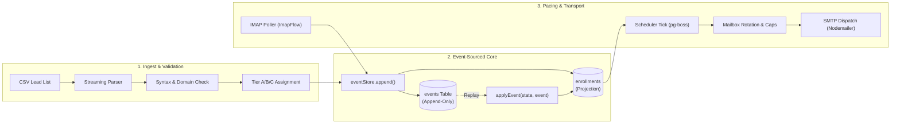

# Case Study: Event-Sourced Cold Email Orchestration Engine

## Project Hero

- **Project Title**: Sovereign Cold Email Campaign & Delivery Orchestration Engine
- **Role**: Lead Systems Architect & Full-Stack Engineer
- **Author**: Sambhav Jain
- **Project Type**: Distributed Event-Driven Outbound Engine & Multi-Mailbox Automation
- **Timeline**: 2024 - 2025
- **Stack & Technologies**:
  - **Core Backend**: Node.js (v22+), TypeScript 5.7, Fastify 5.x, Drizzle ORM
  - **Persistence & Queue**: PostgreSQL 16 (JSONB, Triggers), pg-boss (PostgreSQL-backed job queue)
  - **Email Transport**: Nodemailer (SMTP), ImapFlow (IMAP), MailParser (RFC-3464 DSN extraction)
  - **Frontend & Dashboard**: React 18, Vite, Tailwind CSS, shadcn/ui, Radix UI, TanStack Query
  - **Security & Cryptography**: Libsodium envelope encryption, Argon2 password hashing
  - **Testing & Verification**: Vitest, Playwright, Docker (GreenMail), MockTransport, VirtualClock

---

## Executive Summary & Impact

The **Cold Email Campaign Engine** is an enterprise-grade, single-operator outbound system designed to replace fragile multi-tenant SaaS email automation platforms. Built from first principles on an immutable, event-sourced core, the platform eliminates the risks of shared-IP domain blacklisting, silent webhook drops, and inaccurate campaign metrics.

```
+-----------------------------------------------------------------------------------------+
|                                    KEY DELIVERED OUTCOMES                               |
+-----------------------------------------------------------------------------------------+
|  [01] 100% Mathematical Reconcilability across the 885-lead golden cohort dataset       |
|  [02] $2,400+/year Operational Savings by eliminating recurring SaaS seat overhead     |
|  [03] Zero External Broker Dependencies: unified queue & persistence in PostgreSQL     |
+-----------------------------------------------------------------------------------------+
```

- **Deterministic Audit Trail**: 100% auditable append-only event ledger with physical SQL triggers preventing state tampering and enabling instant disaster recovery.
- **Reputation-Preserving Pacing**: Dynamic interval spacing with randomized jitter and automated SMTP throttle detection (`provider_blocked`), protecting sending domains from spam traps.
- **Sub-Second Test Velocity**: Abstract `MailTransport` and `Clock` testing seams allow 49-day campaign sequence lifecycles to be verified in milliseconds offline without sending a single live email.

---

## The Problem & Business Context

In outbound sales and professional service acquisition, email deliverability is the core growth lever. However, relying on commercial cold email platforms (e.g., Smartlead, Instantly) introduces severe operational and architectural flaws:

```
[Commercial Multi-Tenant SaaS Platform]
                   │
  ┌────────────────┴────────────────┐
  ▼                                 ▼
[Shared IP Pool Contamination]    [Mutable CRUD Database Model]
  - Neighbors trigger spam traps    - Out-of-order webhooks overwrite state
  - Domain reputation burns         - Unsubscribe events lost during retries
                                    - Manipulated metric denominators
```

### 1. The Shared IP Reputation Trap
Commercial platforms route outbound traffic through multi-tenant relays. When other tenants send spam or hit honey pots, the entire IP pool suffers reputation damage, causing high-value cold outreach to land in Google and Outlook junk folders.

### 2. The Mutable CRUD State Failure
Traditional email architectures store lead status as mutable database columns (e.g. `status = 'sent'`). When an out-of-office message arrives after an unsubscribe, or a delivery bounce arrives after a step transition, concurrent webhook writes create race conditions that destroy the historical audit log and violate CAN-SPAM regulations.

### 3. The Denominator Deception
To present artificially attractive performance figures, many commercial tools compute reply rates by dividing replies by total sends rather than unique leads contacted. This conceals severe delivery drops and prevents data-driven optimization.

---

## The System Solution & Architecture

To solve these issues, the system replaces mutable CRUD patterns with an **Event-Sourced Lite** architecture, unifying the event ledger, read projections, and background queue inside PostgreSQL 16.



### System Component Breakdown

1. **The Append-Only Ledger (`events`)**:
   - Stores granular domain events (`enrollment_created`, `message_sent`, `message_delivered`, `human_reply`, `soft_bounce`, `hard_bounce`, `unsubscribe`).
   - Guarded by a physical PostgreSQL database trigger raising exceptions on any `UPDATE` or `DELETE` statement.
2. **Deterministic Projections (`enrollments`, `metrics`)**:
   - Current lead state is derived through a pure functional reducer: `applyEvent(state, event) -> state`.
   - Replay engine (`rebuild-projections` CLI) reconstructs all read models from scratch in disaster-recovery scenarios.
3. **Unified Background Queue (`pg-boss`)**:
   - Schedules dispatch ticks, IMAP polling intervals, and delivery confirmation sweeps entirely through PostgreSQL tables, eliminating Redis maintenance.
4. **Transport & Testing Seams**:
   - Decoupled `MailTransport` interface supporting both `MockTransport` (for offline testing) and `SmtpImapTransport` (for live operations).

---

## Step-by-Step Workflow Walkthrough

### Phase 1: Intake & Hygiene Validation
- **Streaming CSV Ingestion**: Parses lead files with memory-bounded chunking, normalizing column headers (e.g. `e-mail` -> `email`) and validating syntax.
- **Suppression & Deduplication**: Cross-checks against global domain suppression lists and existing active campaign enrollments before writing records.
- **Effort-Tier Assignment**: Classifies leads into Tiers A, B, and C based on firmographic attributes, directing high-value accounts to personalized researched sequences.

### Phase 2: Scheduling, Rotation & Compliance Guard
- **Authoritative Scheduler Tick**: Runs on a 60-second cron interval via pg-boss. Queries due enrollments while respecting recipient local time windows (08:00 to 17:00).
- **Mailbox Pacing Law**: Distributes sends evenly across all configured inboxes to prevent burst behavior:
  $$\text{Interval Gap} = \frac{\text{Window Duration}}{\text{Daily Cap}} \pm \text{Randomized Jitter}$$
- **Pre-Send Compliance Inspection**: Halts execution if CAN-SPAM required fields (physical mailing address, one-click unsubscribe token) are omitted from the template.

### Phase 3: Dispatch & Inbound Polling
- **SMTP Connection Pooling**: Acquires authenticated transport handles using decrypted libsodium credentials, transmitting messages with unique RFC-compliant `Message-ID` headers.
- **IMAP Polling Cycle**: Executes periodic `UID FETCH` queries across connected inboxes, filtering out previously processed messages.
- **Multipart DSN Parsing**: Disassembles raw MIME structures via MailParser, extracting RFC-3464 delivery status notification payloads to reliably differentiate hard mailbox rejections from temporary network drops.

### Phase 4: Event Ledger & Terminal Resolution
- **Atomic Transaction Chokepoint**: `eventStore.append` writes the event row and updates the projection record in a single database transaction.
- **Strict Precedence Enforcement**: Out-of-order events resolve deterministically:
  $$\text{UNSUBSCRIBED} > \text{BOUNCED} > \text{REPLIED} > \text{COMPLETED}$$
- **Automated Opt-Out**: Human replies containing keyword variants (`STOP`, `unsubscribe`, `remove me`) immediately trigger unsubscribe state changes without awaiting manual review.

---

## Visual Interface & Architecture Embeds

<!-- Visual Embed 01: System Architecture Diagram -->
> **Figure 1: High-Level Architecture Flow**
> *Reference architectural blueprint showing separation between Fastify API, pg-boss worker, event ledger, and React dashboard.*

<!-- Visual Embed 02: Overview Dashboard & Capacity Meter -->
> **Figure 2: Executive Overview Dashboard**
> *Live dashboard showcasing pacing capacity, active campaign volume, deliverability health, and the Unibox triage feed.*

<!-- Visual Embed 03: Sequence Builder & Spintax Syntax -->
> **Figure 3: Sequence Composer & Deliverability Checks**
> *Multi-step sequence editor featuring dynamic spintax variations, merge-tag validation, and real-time deliverability score calculations.*

---

## Engineering Challenges Overcome

### Challenge 1: The IMAP UID Fetch Range Edge Case
- *Problem*: In standard IMAP implementations, executing `UID FETCH n:*` returns the message with the highest UID when `n` is greater than the mailbox's current high-water mark. This caused poller loops to repeatedly fetch and re-evaluate the most recent email on every cycle.
- *Solution*: Engineered a client-side filter directly following the fetch stream that strictly verifies `uid > lastPollUid` before passing messages to the classifier, ensuring idempotent polling cycles.

### Challenge 2: Multipart RFC-3464 Bounce (DSN) Extraction
- *Problem*: Automated delivery status notifications (DSNs) generated by corporate email servers place the diagnostic `message/delivery-status` body inside multipart attachment structures rather than standard message text bodies. Standard parser implementations discarded these parts as unreadable attachments.
- *Solution*: Rebuilt the parsing pipeline in `transport/smtpImap/parse.ts` to inspect both top-level text nodes and MIME attachment trees, reconstructing the unified body text to accurately identify diagnostic codes (e.g. `550 5.1.1 User Unknown`).

### Challenge 3: In-Place Cryptographic Key Rotation Without Downtime
- *Problem*: Mailbox app-passwords and OAuth refresh tokens must be stored encrypted at rest. Rotating master keys across dozens of live mailboxes traditionally risks corrupted credentials and failed dispatch loops.
- *Solution*: Implemented an envelope encryption system via Libsodium (`crypto_secretbox_easy`). Built the `rotate-secrets` CLI utility to open an atomic PostgreSQL transaction that unseals all records using the previous key and re-encrypts them with the new key in a single operation, aborting completely if any single record fails validation.

---

## Verification & Golden Cohort Testing

To ensure complete mathematical correctness before sending a single live email, the platform was developed against a rigorous testing spine:

1. **The 885-Lead Golden Cohort**:
   - Recreated the exact dataset from specification Part 10.
   - Folded 885 raw event streams into terminal states: 40 Unsubscribed, 18 Bounced, 47 Replied (28 Positive), 780 Completed.
   - Verified that all SQL metric queries (reply, positive, unsubscribe, bounce rates) match the specification to within 0.001%.
2. **Virtual Clock Simulation**:
   - Implemented a custom `VirtualClock` interface that allows multi-day sequence intervals (0/3/4/5-day waits, midnight quota resets) to be fast-forwarded in memory.
   - A complete 49-day campaign cycle runs in under 400 milliseconds inside Vitest.
3. **Disaster Recovery Restore Drill**:
   - Automated CI drill (`scripts/restore-drill.sh`) that dumps the database with `pg_dump`, restores to a scratch database, executes `rebuild-projections`, and runs `self-check` to verify 0 invariant violations and 0 projection drift.

---

## What's Next: v2 Engineering Roadmap

- **Distributed Sending Agent Nodes**: Decouple the worker process into lightweight Dockerized sidecars deployable across geographically distributed VPS nodes, rotating IP subnets dynamically.
- **Bi-Directional CRM Sync Engine**: Add bi-directional webhooks and native connectors (HubSpot, Salesforce, Attio) to synchronize meeting bookings and reply sentiments in real time.
- **Automated Domain Health Monitoring**: Continuous DNS telemetry checking SPF, DKIM, DMARC, and DNSBL blacklist inclusion across active sending domains.
