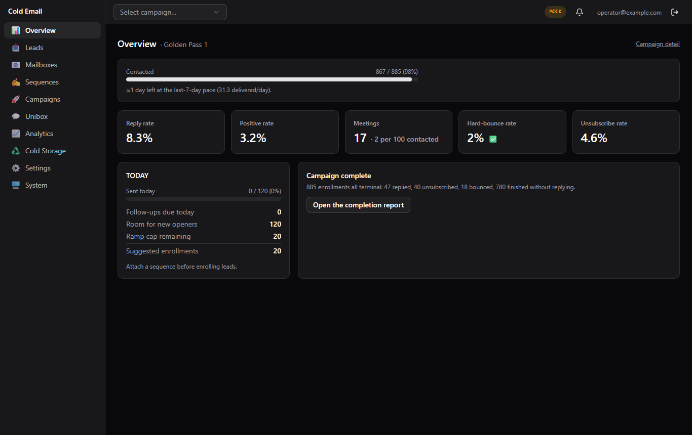
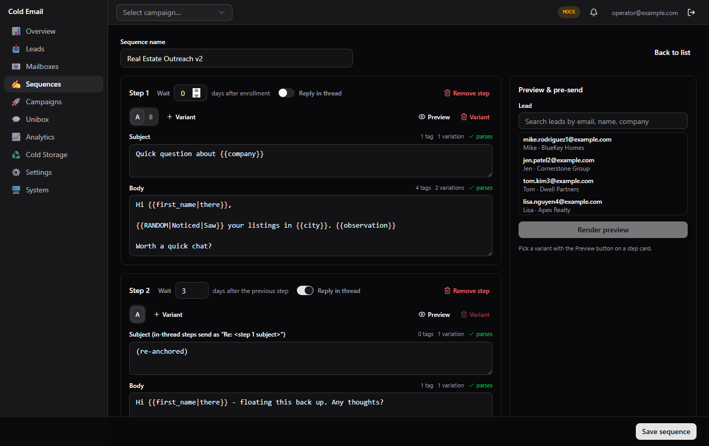
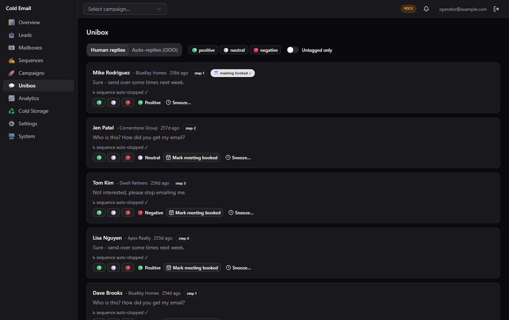
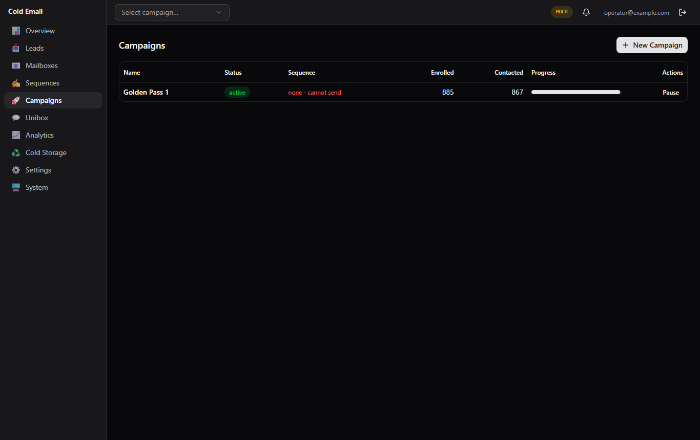
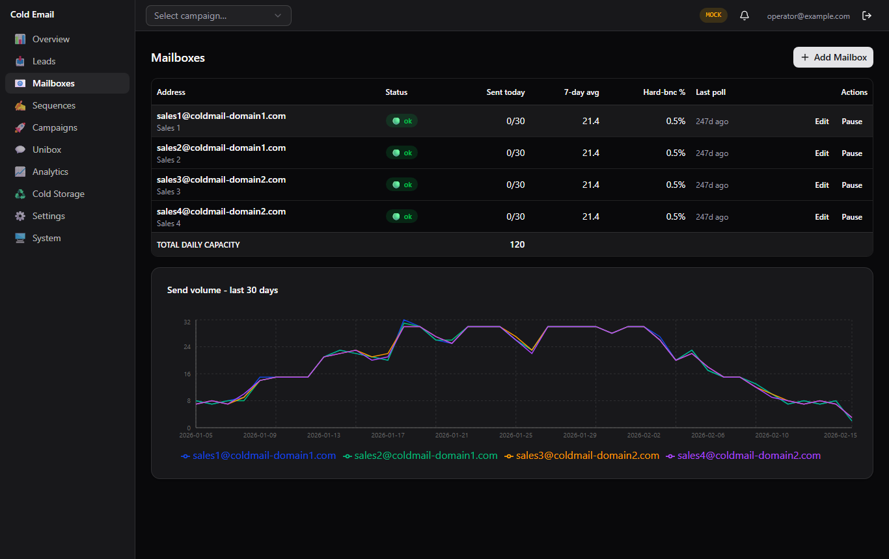
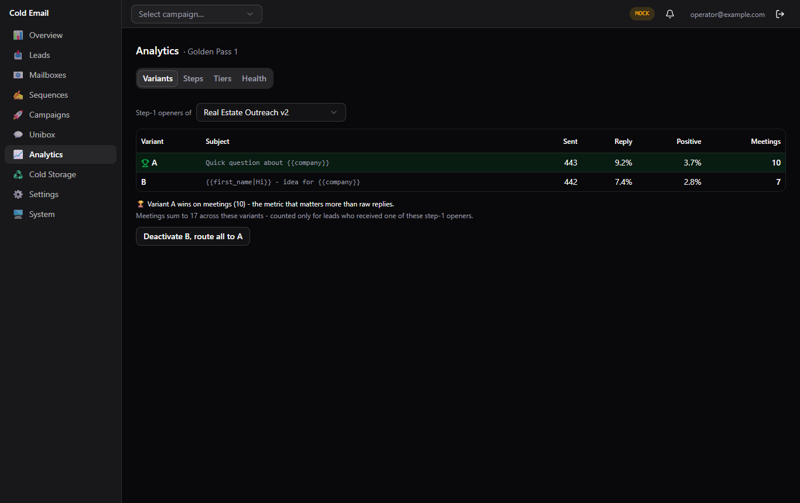
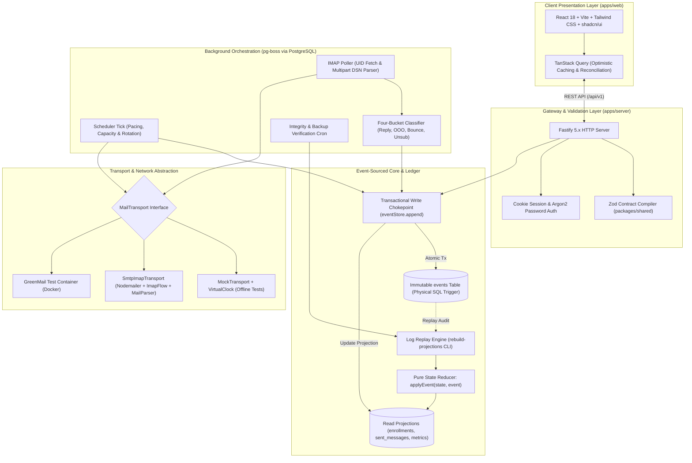

# Cold Email Campaign Engine: Event-Sourced Outbound Platform

[](LICENSE)
[](https://nodejs.org/)
[](https://www.typescriptlang.org/)
[](https://fastify.dev/)
[](https://www.postgresql.org/)
[](https://orm.drizzle.team/)
[](https://github.com/timgit/pg-boss)
[](https://react.dev/)
[](https://tailwindcss.com/)
[](https://vitest.dev/)

> A production-grade, single-operator cold email orchestration platform featuring an append-only event-sourced ledger, mathematically reconciled analytics projections, multi-mailbox SMTP/IMAP rotation, automated four-bucket inbound classification, and complete offline simulation.

---

## 1. Executive Dashboard & Visual Tour

### Executive Overview Console
Real-time capacity pacing, active campaign monitoring, deliverability health gauges, and live Unibox reply feed.



### Multi-Step Sequence Composer & Deliverability Guard
Multi-step sequence editor featuring dynamic spintax variations, merge-tag validation, custom observations, and deterministic delivery score rubrics.



### Unified Unibox & Inbound Classification Feed
Unified communication stream grouping threads, automated stop/unsubscribe detection, and AI-suggested sentiment tagging.



### Campaign Lifecycle & Step Telemetry
Comprehensive campaign enrollment tracking, status toggles, effort-tier distribution, and cohort progress.



### Mailbox Fleet & Pacing Capacity
Multi-mailbox rotation with health scoring, send caps, warm-up status, and IMAP connection telemetry.



### Analytics & Golden Cohort Reconciliation
Four-tab analytics suite (Overview, Tiers, Steps, Variants) with automated self-checking reconciliation footers.



---

## 2. Problem Solved & Operational Context

Commercial cold outbound platforms (e.g., Smartlead, Instantly, Apollo) present critical engineering and operational liabilities for high-touch, reputation-sensitive outreach:

1. **The Shared-IP Reputation Trap**: Multi-tenant SaaS vendors pool SMTP infrastructure across hundreds of accounts. A single spammer on the shared network degrades deliverability across every tenant, landing legitimate domains in Google and Microsoft spam folders.
2. **Black-Box Metrics & Denominator Drift**: Commercial platforms frequently compute vanity statistics using manipulated denominators (e.g., calculating reply rate over total emails sent rather than unique leads contacted), creating misleading campaign telemetry and hiding severe deliverability drop-offs.
3. **State Mutation Failures & Out-of-Order Webhooks**: Traditional CRUD backends update rows directly when webhooks arrive. If a recipient bounces after an out-of-office response, or an unsubscribe arrives after a sequence finishes, concurrent writes overwrite historical audit trails, corrupting sequence progression and violating CAN-SPAM compliance.
4. **Runaway Operational Overhead**: Paying \$150 to \$500+ every month per operator seat for multi-tenant services adds unnecessary friction for sovereign solo operators, boutique agencies, and independent consultancies.

This platform solves these bottlenecks by implementing an **authoritative, single-tenant, event-sourced outbound engine** hosted on sovereign infrastructure. It guarantees strict delivery pacing, zero external queue dependencies (PostgreSQL-backed pg-boss), deterministic projection rebuilds, and automated four-bucket IMAP inbound parsing.

---

## 3. System Architecture

The monorepo (`@coldemail/server`, `@coldemail/web`, and `@coldemail/shared`) maintains a strict dependency hierarchy. Domain logic is 100% pure (no I/O, no wall-clock dependencies), write operations flow through a single transactional chokepoint (`eventStore.append`), and all DTO schemas are statically and runtime validated via Zod.



---

## 4. Core Architectural Mechanisms

### A. The Append-Only Event Ledger & Reducer Folding
- **Immutable Table**: The `events` table enforces an append-only rule through a database-level trigger that raises an exception on any `UPDATE` or `DELETE` attempt. The application database role lacks mutation privileges on historical events.
- **Pure Functional Reducer**: Lead state is never stored as an arbitrary mutable row; it is computed by folding `applyEvent(state, event)` across an enrollment's event stream.
- **Terminal Priority Precedence**: Conflicting out-of-order inbound events resolve deterministically using a strict priority hierarchy:
  $$\text{UNSUBSCRIBED} > \text{BOUNCED} > \text{REPLIED} > \text{COMPLETED}$$
- **Disaster Recovery Replay**: The `rebuild-projections` CLI replays the entire event log from tick zero to reconstruct every projection table. If a database corruption or logic bug occurs, the log is the single source of truth.

### B. Multi-Mailbox Rotation & Safe Pacing
- **Pacing Interval Law**: To protect domain reputation and prevent burst sending, the scheduler calculates minimum dispatch intervals per mailbox:
  $$\text{Pace Gap} = \frac{\text{Sending Window (ms)}}{\text{Daily Cap}} \pm \text{Jitter}$$
- **Never-Burst Delivery**: If the system starts late in the day, it never dumps accumulated backlog in a burst. It caps dispatch strictly to the remaining available capacity intervals.
- **Automatic Health Throttling**: Tracks consecutive SMTP responses. Receiving 5 consecutive throttle responses (`421` / `4.7.0`) triggers an immediate `provider_blocked` status, automatically reallocating queued enrollments to healthy peer mailboxes.

### C. Inbound Classification & Thread Matching
- **IMAP Poller & UID Fetch**: Leverages `ImapFlow` with strict high-water mark UID tracking (`UID FETCH n:*` with client-side `uid > lastPollUid` filtering) to eliminate duplicate message processing.
- **Four-Bucket Message Classifier**:
  1. *Human Reply*: Matched against outgoing `Message-ID`, `References`, and `In-Reply-To` headers.
  2. *Out-of-Office (OOO)*: Auto-responder keywords identified without interrupting the lead's active sequence.
  3. *Delivery Status Notification (Bounce)*: Extracts RFC-3464 `message/delivery-status` structures from multipart attachments to distinguish recipient hard bounces (`5.1.1`) from mailbox authentication errors.
  4. *Plain-Text Opt-Out*: Automated detection of `STOP`, `unsubscribe`, or cancel requests immediately executing compliance unenrollment.
- **AI Sentiment Tagging (Optional Adapter)**: Structured pre-classification (`positive`, `neutral`, `negative`) via an official Anthropic API adapter. Operates with thinking disabled and fixed token budgets for sub-3-second latency, leaving human tagging as the final authority.

### D. The Locked 885-Lead Golden Cohort
The platform includes an authoritative, mathematically reconciled 885-lead benchmark cohort (Part 10 specification) verified at three testing levels:
- **L1 Raw Events**: 885 leads folded through `applyEvent` to exact terminal outcomes: 40 Unsubscribed, 18 Hard Bounced, 47 Replied (28 Positive, 19 Neutral/Negative), 780 Completed.
- **L2 Derived Metrics**: Exact SQL aggregate verification (Reply Rate: 8.3%, Positive Rate: 3.2%, Unsubscribe Rate: 4.6%, Bounce Rate: 2.0%, 17 Meetings Booked).
- **L3 Full Pipeline**: 49-day virtual-clock campaign simulation executing all multi-day wait intervals, midnight cap resets, and IMAP poll loops in sub-second test execution.

---

## 5. Repository Layout & Workspaces

The monorepo uses npm workspaces with strict TypeScript project boundaries:

```
cold-email-campaign/
├── apps/
│   ├── server/                 # Fastify, Drizzle ORM, pg-boss worker, event-sourced core
│   │   ├── src/
│   │   │   ├── domain/         # Pure functional logic: events, reducer, precedence, invariants
│   │   │   ├── db/             # Drizzle schemas, migrations, repositories
│   │   │   ├── services/       # Transactional eventStore, metrics, backup, rotation
│   │   │   ├── transport/      # Abstract MailTransport, MockTransport, SmtpImapTransport
│   │   │   ├── scheduler/      # Pacing, capacity, time zones, mailbox rotation
│   │   │   ├── poller/         # IMAP cycle, classifier, DSN parser, threading
│   │   │   ├── render/         # Template engine, spintax, CAN-SPAM compliance guards
│   │   │   ├── ingest/         # CSV streaming, hygiene validator, tiering
│   │   │   ├── api/            # Fastify route modules, session plugins, CSRF protection
│   │   │   └── composition.ts  # Single dependency injection composition root
│   │   └── test/               # Unit, integration, golden cohort, and API test suites
│   └── web/                    # React 18 SPA (Vite, Tailwind CSS, shadcn/ui, TanStack Query)
│       ├── src/
│       │   ├── api/            # Type-safe API client validating shared Zod contracts
│       │   ├── components/     # Radix UI primitives, shared layout, data tables
│       │   ├── features/       # Overview, Campaigns, Sequences, Unibox, Analytics, Settings
│       │   └── mocks/          # MSW service worker simulating full backend contract
│       └── e2e/                # Playwright user journey and walkthrough replays
├── packages/
│   └── shared/                 # Zero runtime dependencies except Zod
│       └── src/                # API DTO schemas, domain enums, pagination envelopes
├── docs/                       # Complete specification suite (00-INDEX through 16-deployment-ops)
│   └── screenshots/            # High-resolution production UI captures
├── docker-compose.yml          # PostgreSQL 16 (dev port 5433) + GreenMail test mail server
└── docker-compose.prod.yml     # Self-contained production container topology
```

---

## 6. Local Setup & Quickstart

### Prerequisites
- Node.js >= 22 (tested on v24.18.0)
- Docker & Docker Compose
- npm >= 10

### 1. Clone Repository & Install Dependencies
```bash
git clone https://github.com/SambhavJain26/cold-email-campaign.git
cd cold-email-campaign
npm install
```

### 2. Configure Environment Variables
```bash
cp .env.example .env
```
Generate secure 32-byte hexadecimal secrets for session cookies and envelope encryption:
```bash
node -e "console.log('SESSION_SECRET=' + require('crypto').randomBytes(32).toString('hex'))"
node -e "console.log('SECRET_KEY=' + require('crypto').randomBytes(32).toString('hex'))"
```

### 3. Start Database & Mail Infrastructure
Start PostgreSQL 16 (running on mapped port `5433` to prevent conflicts with local databases) and GreenMail:
```bash
docker compose up -d
```

### 4. Apply Database Migrations & Seed Baseline Settings
```bash
npm run db:migrate
```

### 5. Launch Development Services
Start the Fastify API server and the Vite React frontend concurrently:
```bash
# Terminal 1: Backend Server (Port 3001)
npm run dev -w @coldemail/server

# Terminal 2: Web Dashboard (Port 5173)
npm run dev -w @coldemail/web
```
Access the web dashboard at `http://localhost:5173` and authenticate using the seeded credentials configured in `.env`.

---

## 7. Verification & Test Suites

The repository enforces strict verification across unit, integration, and golden regression tiers:

```bash
# Typecheck all workspaces
npm run typecheck

# Code formatting and lint verification
npm run lint
npm run format:check

# Run unit and integration tests (Vitest)
npm run test

# Run the locked 885-lead golden cohort regression suite
npm run test:golden

# Run the live SMTP/IMAP transport test suite (against Docker GreenMail)
npm run test:mail

# Run the full disaster-recovery restore drill
bash scripts/restore-drill.sh
```

---

## 8. Technical Decisions & Trade-Offs

| Decision Area | Chosen Approach | Alternative Considered | Trade-Off Rationale |
|---|---|---|---|
| **Persistence Model** | Event-Sourced Lite (`events` + derived projections) | Mutable CRUD (`UPDATE leads SET status = ...`) | CRUD models overwrite state on out-of-order webhooks. Event sourcing guarantees a 100% auditable history and enables complete disaster recovery via `rebuild-projections`. |
| **Queue Architecture** | pg-boss (PostgreSQL-backed queue) | Redis + BullMQ | Eliminates operational overhead of maintaining a separate Redis cluster on a single VPS. PostgreSQL transactions guarantee atomic job creation and event insertion. |
| **API Contract Validation** | Shared Zod schemas (`packages/shared`) | OpenAPI YAML / tRPC | Zod provides both runtime validation at HTTP boundaries and compile-time TypeScript types without code-generation build steps. Contract violations fail fast with HTTP 500. |
| **Testing Harness** | MockTransport + VirtualClock | Real test inboxes | Testing 49-day sequence rules with real email introduces flakiness and high latency. Virtual clocks allow comprehensive multi-day regressions to execute deterministically in milliseconds. |
| **Transport Security** | Libsodium sealed envelopes at rest | Plaintext credentials | Storing raw mailbox passwords in the database creates extreme security risk. Libsodium encrypts credentials with automated zero-leak log auditing. |

---

## 9. License & Authorship

- **Architect & Author**: Sambhav Jain
- **License**: MIT License: see the [LICENSE](LICENSE) file for complete details.
