# Cold Email Campaign — Complete User Manual

**Audience:** a new operator using the application for the first time

**Application model:** single-operator, self-hosted cold-email campaign console

**Manual version:** 2026-08-30, for branch `canary`

**Reconciled through:** the locally verified Personalized Copy/two-tier/campaign-filter candidate.
Spaceship production remains pinned to application code `6ca1183`; this candidate is not deployed.

This manual explains the complete operator-facing application: what every screen does, how to use
each action, what the system does automatically, and which safeguards or edge cases matter. It is a
product-use guide, not legal advice and not a promise of email deliverability.

For simpler explanations, worked examples, and product-design context, also
read [User Manual Companion: Plain-Language Answers and Product Notes](20-user-manual-questions.md).

The screenshots use the application's built-in representative dataset so controls can be shown
without changing production. Names, dates, addresses, counts, and `MOCK` status in the images are
examples. They were recaptured after the Stage 4 responsive redesign. Follow the written rules and
the values displayed in your live session.

> **Current-environment warning:** Spaceship is the production deployment at
> `https://sambhavpmtech.com/email-campaign/`. Oracle remains a paused rollback canary. A green
> `LIVE` transport badge means the application is
> connected to real SMTP/IMAP; it does **not** mean domains are warmed, DNS is ready, a list is
> lawful, or a campaign is safe to launch. Complete the pre-launch checklist in this manual before
> sending to prospects.

> **Candidate-versus-production warning:** the current `canary` code replaces Manual Compose
> sending with sequence-only **Personalized Copy**, offers only current Tier A/Tier B/Untiered,
> separates Nurture into an outreach hold, and adds Campaign Pool/Enrolled/Both lead filtering.
> Older screenshots and historical passages that show Tier C, Nurture as a tier, Mode 1, or a
> Manual Compose Send button describe the still-deployed predecessor. See
> [the migration 0019 guide](22-personalized-copy-two-tier.md). Do not expect these candidate
> controls in production until a separately authorized deployment is completed.

## Contents

1. [What the application does](#1-what-the-application-does)
2. [How the parts fit together](#2-how-the-parts-fit-together)
3. [Accessing the application](#3-accessing-the-application)
4. [Essential concepts and statuses](#4-essential-concepts-and-statuses)
5. [Recommended first-time workflow](#5-recommended-first-time-workflow)
6. [Global navigation and controls](#6-global-navigation-and-controls)
7. [Overview](#7-overview)
8. [Leads](#8-leads)
9. [Mailboxes](#9-mailboxes)
10. [Sequences](#10-sequences)
11. [Campaigns](#11-campaigns)
12. [Unibox](#12-unibox)
13. [Analytics](#13-analytics)
14. [Cold Storage](#14-cold-storage)
15. [Settings](#15-settings)
16. [System](#16-system)
17. [Public unsubscribe experience](#17-public-unsubscribe-experience)
18. [What happens automatically](#18-what-happens-automatically)
19. [Safety, compliance, and data handling](#19-safety-compliance-and-data-handling)
20. [Incident and troubleshooting guide](#20-incident-and-troubleshooting-guide)
21. [Pre-launch checklist](#21-pre-launch-checklist)
22. [Daily operating checklist](#22-daily-operating-checklist)
23. [Glossary and quick reference](#23-glossary-and-quick-reference)

---

## 1. What the application does

The application manages a cold-email workflow from lead intake through campaign analysis:

- imports or creates leads while enforcing hygiene, deduplication, and suppression;
- organizes leads into effort tiers;
- connects outbound mailboxes over SMTP and reads replies/bounces over IMAP;
- builds multi-step sequences with merge tags, deterministic spintax, variants, waits, and
  threading;
- enrolls leads into campaigns while reserving capacity for follow-ups;
- sends gradually inside configured limits and never dumps an overdue backlog in one burst;
- detects bounces, out-of-office messages, human replies, and opt-outs;
- stops every sequence when a human reply is detected;
- records reply outcomes, sentiment, meetings, suppressions, and recontact restrictions;
- calculates campaign, step, tier, variant, mailbox, and health analytics from an append-only event
  history;
- supports rested second-pass campaigns without allowing identical messages to be resent; and
- exposes system health, alerts, domain-readiness checks, poller history, and projection integrity.

The application deliberately does **not** purchase domains, warm inboxes, verify list legality,
guarantee inbox placement, or decide whether contacting a person is legally permitted.

## 2. How the parts fit together

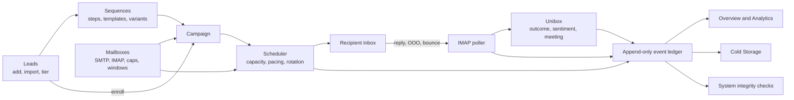

The event ledger is the source of truth. Screens such as campaign state, metrics, and timelines are
projections derived from those immutable facts. Historical sends and events are not edited to make
an outcome disappear.

## 3. Accessing the application

Open the production URL in a modern browser:

```text
https://sambhavpmtech.com/email-campaign/
```

The trailing slash is canonical. Direct links such as `/email-campaign/campaigns/12` and
`/email-campaign/mailboxes` work after sign-in. Normal traffic elsewhere on the two outreach
domains redirects to the portfolio; the application path is the intentional exception.

Oracle is a paused rollback/canary environment and normally needs its SSH tunnel. Do not use it for
production work unless the operator deliberately invokes the rollback runbook.

### 3.1 Sign in

Enter the operator email and password. The application has one operator account; it has no roles,
teams, or additional user invitations.

- Invalid credentials produce an inline error.
- Repeated failed attempts can produce a rate-limit warning; wait before retrying.
- After sign-in, the app returns to the originally requested protected page when possible.
- Use the sign-out icon at the top right when finished.

Never paste the operator password, mailbox app password, OAuth client secret/refresh token, `.env`
values, `SECRET_KEY`, or `SESSION_KEY` into chat, tickets, screenshots, or documentation.

### 3.2 If the operator password is forgotten

There is no email-based **Forgot password** screen and the existing password cannot be displayed or
recovered. A VPS administrator must set a new password with the password-reset command documented in
[16-deployment-ops.md](16-deployment-ops.md). Editing `OPERATOR_INITIAL_PASSWORD` after first boot
does not change the stored login, and `.env.prod.example` must never contain real credentials.

## 4. Essential concepts and statuses

### 4.1 Lead tiers

| Tier | Intended use | Normal treatment |
|---|---|---|
| A | Best-fit, highest-value leads | Template steps use researched observation; personalized steps use saved copy |
| B | Broader qualified segment | Template steps use campaign Auto Observation rules; personalized steps use saved copy |
| Untiered | Newly imported or not yet reviewed | May be reserved in a campaign pool but cannot enroll |

Nurture is a separate outreach status, not a tier. Nurture leads cannot enroll; restoring one from
Nurture makes it Untiered. Tier is a prioritization and template-data decision, not consent.
Changing a lead's tier affects future enrollments. Each enrollment snapshots its tier and mode, so
historical Tier C/Nurture/human-written analytics remain accurate with a Legacy label.

### 4.2 Enrollment states

| State | Meaning |
|---|---|
| `NEW` | Enrollment exists but has not entered active sending |
| `ACTIVE` | A step is due now or scheduled for later |
| `REPLIED` | A human reply was detected; the sequence has stopped |
| `BOUNCED` | A hard bounce occurred or the soft-retry limit was exceeded |
| `UNSUBSCRIBED` | An opt-out was recorded; this has the highest terminal priority |
| `COMPLETED` | The final step passed its delivery-confirmation window without a stronger terminal event |

Terminal priority is `UNSUBSCRIBED` → `BOUNCED` → `REPLIED` → `COMPLETED`. For example, a late
unsubscribe remains an unsubscribe even if the enrollment had previously completed.

### 4.3 Campaign statuses

| Status | Meaning and effect |
|---|---|
| `draft` | Safe construction state. Nothing sends. |
| `active` | Enrolled due work may send on the next scheduler tick. |
| `paused` | Future sends stop; already accepted email cannot be recalled. IMAP polling can continue. |
| `completed` | All enrollments are terminal. Nothing remains scheduled. |
| `archived` | Deliberately retired; future scheduling is stopped. |

### 4.4 Mailbox statuses

| Status | Meaning | Operator response |
|---|---|---|
| `ok` | Eligible to send and poll | Monitor normally |
| `paused` | Manually paused | Resume only after confirming it is safe |
| `auto_paused` | Bounce protection fired | Review recent leads; resume at reduced cap |
| `setup_required` | OAuth mailbox exists but Google authorization is not connected | Choose Connect Google; the scheduler cannot select it |
| `auth_failed` | Provider rejected credentials or OAuth authorization | Re-enter the app password or reconnect Google |
| `imap_stale` | Replies/bounces may not be arriving | Fix IMAP/folder access before sending continues |
| `provider_blocked` | Repeated provider throttling detected | Leave paused until the provider condition is understood |

### 4.5 Sent, delivered, and contacted

- `sent` means SMTP accepted the message attempt.
- `delivered` is inferred after `delivery_confirm_hours` passes without a bounce. It is not a
  provider inbox-placement receipt.
- `contacted` means the lead has at least one `delivered` event or a human reply. A reply can arrive
  before the delivery-confirmation timer, so replies also count the lead as contacted.

### 4.6 Suppression

A suppressed lead cannot be imported again, selected for enrollment, or sent to. Suppression is
checked at import, enrollment, send time, and event append. Recorded opt-outs are globally
suppressive across campaigns. Hard bounces also create global suppression; exhausting soft-bounce
retries makes the enrollment `BOUNCED` but is not the same as a verified hard-bounce suppression.

## 5. Recommended first-time workflow

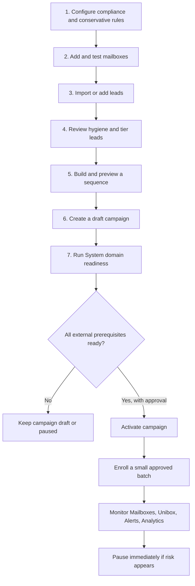

Recommended order:

1. In **Settings → Compliance**, enter the valid business postal address and opt-out wording. Keep
   the unsubscribe base URL blank until a public HTTPS domain is genuinely configured.
2. In **Settings → Rules**, set conservative guardrails and enforce send windows.
3. In **Mailboxes**, add each sender, configure its recipient-time window, include the provider's
   spam folder in polling, and run **Test Connection**.
4. In **Leads**, import a CSV or add one lead. Review every preview category before committing.
5. Tier the leads and add researched observations/custom fields where appropriate.
6. In **Sequences**, create steps and variants, save, preview against representative leads, and fix
   every fatal check.
7. In **Campaigns**, create a draft, confirm the tier-effort mapping and ramp, and keep it draft.
8. In **System**, run domain readiness and a projection dry-run. Read warnings; `ready` means only
   that no automated check failed.
9. Complete the human pre-launch checklist in section 21.
10. Activate only when sending is approved, then enroll a small controlled batch. Enrollment into
    an active campaign can lead to sending on the next scheduler tick.

### 5.1 Current Spaceship commissioning snapshot

As of 2026-08-25, the production application, DNS/TLS routes, isolated unsubscribe hosts, logical
backups, restore drill, Spaceship AutoBackup, Internal Google OAuth client credentials, business
postal address, and `https://unsubscribe.{sender_domain}` template are configured. One Workspace
mailbox is connected through Google OAuth and is healthy, but production still has no campaigns,
leads, or enrollments, so it has no work to send.

Before prospect outreach, the remaining application commissioning sequence is:

1. Run **Test Connection** on the connected OAuth mailbox and confirm both SMTP and IMAP pass,
   `INBOX` and `[Gmail]/Spam` are configured, and a successful poll appears.
2. Review the mailbox's conservative cap, recipient-local window, weekdays, and the global launch
   guardrails. A value below a ceiling is permitted, not proven safe.
3. After separate approval for that one send, complete the single owner-address
   send/reply/unsubscribe canary. Verify received DKIM, reply stopping, the body link, supported
   one-click POST, global suppression, clean self-check/projection drift, and a fresh backup.
4. Finish inbox warming and every lead/legal/copy item in section 21 before importing or contacting
   prospects.

Oracle remains paused as the rollback canary. Do not use or delete it during ordinary production
commissioning.

## 6. Global navigation and controls

The left navigation contains: **Overview, Leads, Mailboxes, Sequences, Campaigns, Unibox,
Analytics, Cold Storage, Settings,** and **System**.

On desktop and tablet, this navigation remains visible while the page content scrolls
independently. On screens narrower than 768 px, use the menu button in the top bar. It opens the
same ten sections in a focus-trapped drawer and closes after navigation. The campaign selector,
alerts, transport status, and sign-out remain available on phones.

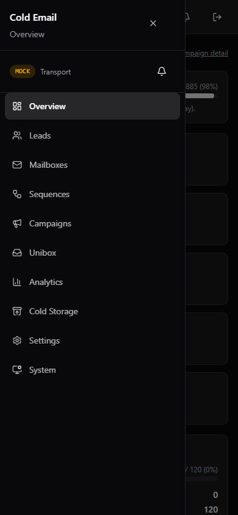

Press **Tab** from the top of a page to reveal **Skip to main content**. This bypasses repeated
navigation for keyboard users. Escape closes open drawers and dialogs and returns focus to the
control that opened them.

### Campaign selector

The top-left selector establishes global campaign context. The selection is stored as
`?campaign=<id>` in the URL and follows you between screens. Paused or draft campaigns are labeled
in the selector. Screens that need a campaign use the selected campaign; when none is selected,
many screens use the first available campaign.

Before interpreting Overview, Analytics, Cold Storage, or a campaign-filtered Leads list, verify
the selected campaign.

### Transport badge

- `MOCK` means no real email should leave the application.
- `LIVE` means the SMTP/IMAP transport is real.

`LIVE` is a technical connection mode, not launch approval or deliverability readiness.

### Alerts bell

The bell shows open alerts and refreshes regularly. Each alert includes a severity, description,
and **Ack** action.

Acknowledging means “I have seen this”; it does not fix the cause or delete history. Full history,
including acknowledged alerts, remains under **System → Alerts history**.

### Global error messages

Failed actions display a toast using the server's error message. Some screens add specific inline
guidance, such as ramp-cap refusals, fatal render checks, or unhealthy mailbox errors.

## 7. Overview

Overview is the campaign command summary.

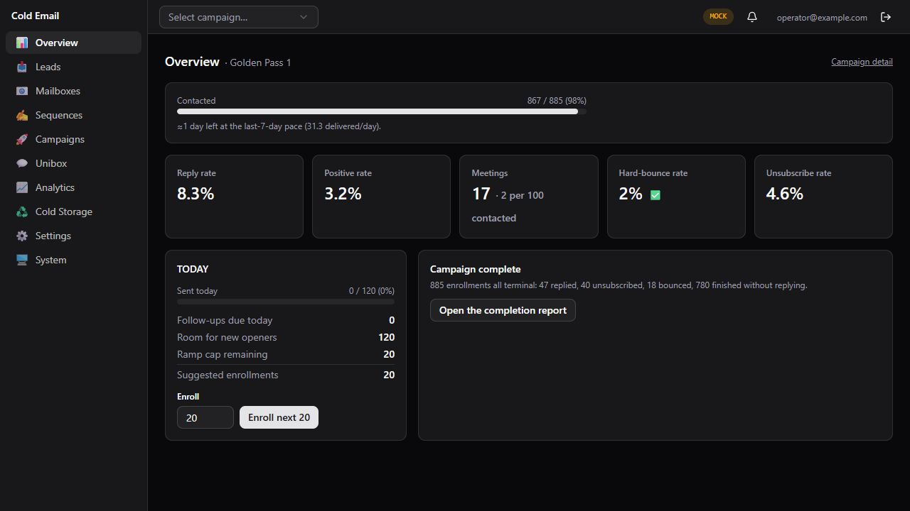

### Header and campaign detail

The heading shows the selected campaign. **Campaign detail** opens its full configuration,
enrollment breakdown, controls, and completion report.

### Sending-blocked banners

These banners describe conditions that prevent all sends, such as:

- missing physical address;
- no healthy mailbox;
- closed send windows;
- exhausted daily capacity;
- pacing delay; or
- only manual-mode work remaining.

Fix the cause; do not merely acknowledge a related alert.

### Catch-up banner

After downtime, overdue work stays queued behind normal caps and pacing. The banner shows overdue
count and remaining daily mailbox slots. **Acknowledge** hides the open banner but does not change
the backlog.

### Watch flags

Warnings point to **Analytics → Health**. They are early signals, not diagnoses. Common signals are
increasing unsubscribes or deteriorating reply performance.

### Progress and estimated completion

Progress is contacted leads divided by total enrollments. The estimated days remaining uses the
last seven days' delivered pace. No estimate is shown when there is insufficient activity, no
remaining work, or no meaningful pace.

### Metric cards

| Metric | Calculation |
|---|---|
| Reply rate | Distinct human repliers ÷ contacted leads |
| Positive rate | Distinct leads with effective positive sentiment ÷ contacted leads |
| Meetings | Count of meeting-booked events; also shown per 100 contacted |
| Hard-bounce rate | Hard bounces ÷ distinct leads sent to |
| Unsubscribe rate | Distinct unsubscribed leads ÷ contacted leads |

Rates are event-based and may overlap. A person may reply and later unsubscribe.

### TODAY panel

The capacity meter accounts for healthy-mailbox capacity, sends already made today, follow-ups due,
unsent Step-1 openers already reserved for today, and the campaign's ramp or permanent daily cap.
**Enroll next N** uses count-based selection.

Count-based enrollment order is Tier A → B → C → untiered. Legacy global campaigns use
oldest-imported order. Pool-backed campaigns use their reserved candidates and allocation order;
they never silently take unrelated global leads. Nurture leads are excluded. If exact identities
matter, do not assume the count button chooses them.

The panel explains why enrollment is blocked for a draft, paused, archived, or sequence-less
campaign. A capacity refusal lowers the input to the number that currently fits.

## 8. Leads

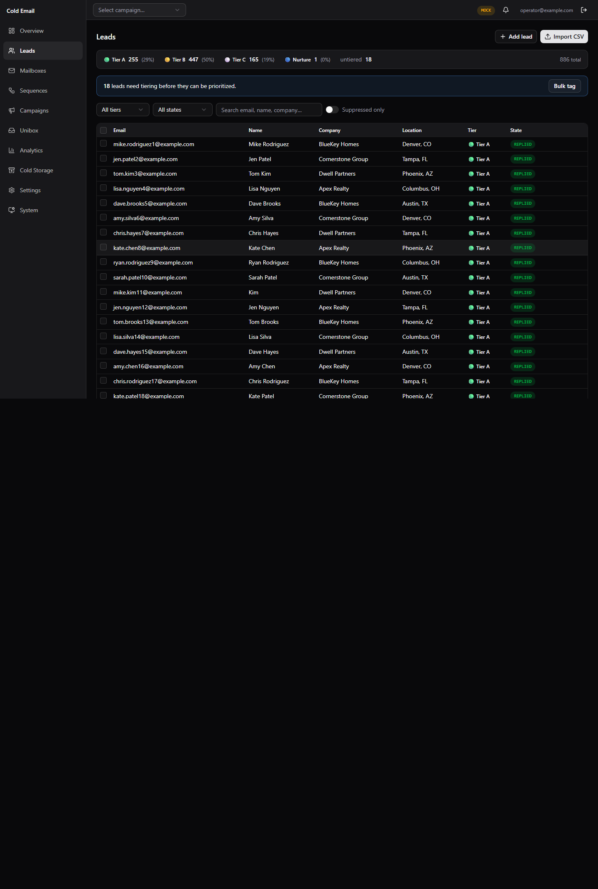

### 8.1 Leads list

The table shows email, name, company, location, tier, latest enrollment state, and a suppression
icon. Clicking a row opens the lead detail.

Filters:

- **Tier:** A, B, untiered, or all.
- **Outreach status:** standard or Nurture.
- **State:** latest enrollment state.
- **Search:** case-insensitive email, name, or company search.
- **Suppressed only:** shows leads that cannot receive email.
- **Campaign:** choose the campaign whose leads you want to inspect or bulk-change.
- **Campaign scope:** **Pool** shows currently available pool members, **Enrolled** shows every
  enrollment state, and **Both** shows the deduplicated union (default). Released-only pool rows
  are excluded unless they also have an enrollment.

Filters reset pagination and selection. Long operational lists default to 25 rows. Use **Rows per
page** below the list to choose 25, 50, or 100; changing it returns to page 1. The footer always
shows the current range and total, even when every item fits on one page.

On phones, the table becomes cards and the filters move into a **Filters** drawer. The same lead
data, selection, actions, active-filter count, and numbered pagination remain available; there is
no sideways page scrolling.

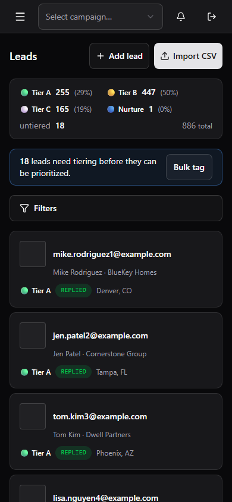

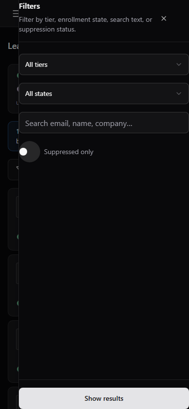

### 8.2 Add one lead

Choose **Add lead**, enter the email and any available first name, company, city, and state, then
submit. The single-add dialog intentionally exposes only those five fields. To load last name,
website, phone, notes, or arbitrary custom fields at creation time, use CSV import; notes and custom
fields can also be edited later on the lead detail screen. This is a one-row import through the same
hygiene, deduplication, and suppression checks as CSV.

Possible refusals:

- invalid email syntax;
- duplicate lead;
- globally suppressed address; or
- role-based address such as `info@`, `sales@`, or `support@`.

This action is intentionally not a shortcut around list safety.

### 8.3 Import CSV

Choose **Import CSV** and drop or select a file.

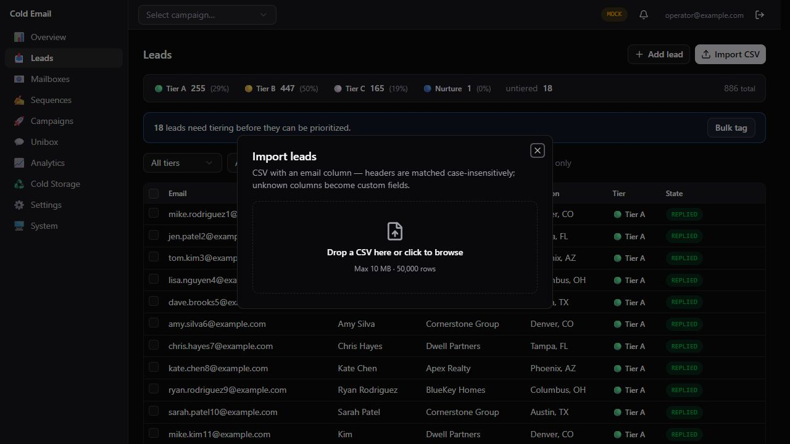

On a phone the import wizard fills the usable viewport and scrolls internally, so its controls do
not disappear behind the browser or on-screen keyboard.


Requirements:

- header row required;
- an email column is required;
- headers are case-insensitive;
- comma, semicolon, and tab delimiters are recognized;
- UTF-8 BOM is accepted;
- maximum 10 MB and 50,000 rows;
- unknown columns become lowercase/snake-case custom fields.

Recognized header aliases include `email`, `e-mail`, `email_address`, `work_email`, common first
and last-name variants, company/business, website/domain, city, state, phone, and notes.

Two optional columns create a global Personalized Copy source:

```csv
email,first_name,company,manual_subject,manual_body
alex@example.com,Alex,Acme,"Idea for Acme","Hi Alex,

I noticed Acme's Austin expansion.

Would comparing notes be useful?"
```

`manual_subject` and `manual_body` must both be present on a row. They form the default source slot,
not ordinary lead custom fields. Add `step_1_subject`/`step_1_body`,
`step_3_subject`/`step_3_body`, and so on for explicit personalized-step mappings. An unescaped
`\n` inside these copy cells becomes a line break; `\\n` stays literal. Quoted RFC multiline cells
also work, and internal quotes are doubled as `""`.

Preview categories:

| Category | Meaning | Import behavior |
|---|---|---|
| Clean | Normal importable row | Imported in either mode |
| Missing first name | Usable with template fallbacks | Imported in either mode |
| Role-based | Shared inbox such as info/support | Dropped by safe mode; admitted by “Import all” |
| Invalid | Broken address syntax | Never imported |
| Duplicate | Repeated in file or already exists | Never imported |
| Suppressed | Prior opt-out or blocking suppression | Never imported in any mode |

**Drop flagged** is the recommended mode. **Import all incl. role-based** adds only role-based
addresses; invalid, duplicate, and suppressed rows remain excluded. Expand **samples** to inspect
representative rows before committing.

All imported leads start untiered.

#### Optional campaign allocation during import

After hygiene preview, expand **Campaign allocation** to reserve exact numbers of the accepted
leads for one or more draft/paused campaigns. For example, add Campaign A = 100 and Campaign B =
100; if the accepted set contains 1,000 unique safe leads, the preview shows 800 remaining global.
Nothing is enrolled or sent by this action.

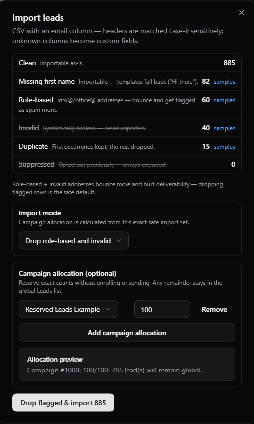

Allocation uses safe accepted leads in CSV row order. Safely linked existing duplicate leads may
also be allocated without replacing their stored name, company, or custom fields. Suppressed,
erased, nurture, currently reserved, actively enrolled, recontact-blocked, and duplicate-content
conflicting leads are excluded. The preview shows the available/excluded totals and whether every
exact request can be satisfied.

When personalized-copy columns are present, all accepted leads retain global source copy. Copies
for allocated leads bind to the compatible personalized campaign steps without changing the
global source. Generic copy auto-binds only when the campaign has one personalized step; multiple
personalized steps require a selected step. Incompatible or conflicting mappings remain
unassigned and are reported.

Commit is all-or-nothing. The server rechecks every condition in one transaction. If another
operation makes an exact count impossible after preview, no leads, drafts, or pool reservations
from that commit are saved; refresh the preview and try again. Import History preserves each
campaign's total, available, enrolled, and released allocation counts.

#### Imported Personalized Copy workflow

The preview separates new/existing leads, complete/incomplete sources, campaign-step bindings, and
content conflicts. Complete copy starts as **needs review**; use **Mark all valid imported copy
ready** only after reviewing the batch. Existing lead profile fields are preserved, and existing
source or campaign copy remains unchanged unless replacement is explicitly selected.

The default conflict action is **keep existing**. Select replacement only when the new CSV should
overwrite unsent source/campaign copy. Suppressed or erased leads never receive copy. The result
reports created, replaced, skipped, invalid, assigned, conflicting, and unassigned totals.

Imported copy:

- creates one global source per lead/slot and independent campaign-step snapshots when assigned;
- start as **needs review**;
- never enroll a lead, activate a campaign, or send automatically; and
- appears in the lead's **Personalized Copy** editor with source-import provenance.

### 8.4 Bulk tiering

Select individual rows or the whole visible page. If more filtered rows exist, choose **Select all
N leads matching the current filter**. Set Tier A, Tier B, or Untiered, or use the separate Nurture
and Restore-from-Nurture actions.

“All matching” acts on the current server-side filter, not only the rows loaded in the browser.
When Campaign is selected, also choose Pool, Enrolled, or Both; the same predicate drives the list,
untiered count, and bulk action, so the exact displayed campaign cohort is changed.

### 8.5 Lead detail

The header shows identity, tier, latest state, and **Erase PII**. The profile card shows contact and
campaign context. The edit card supports:

- tier;
- notes;
- `custom_observation`, used by researched personalization; and
- arbitrary custom-field name/value pairs.

Custom-field names must be non-empty and unique. Any custom field can be used as a sequence merge
tag. Removing a field from the form removes it from the lead after save.

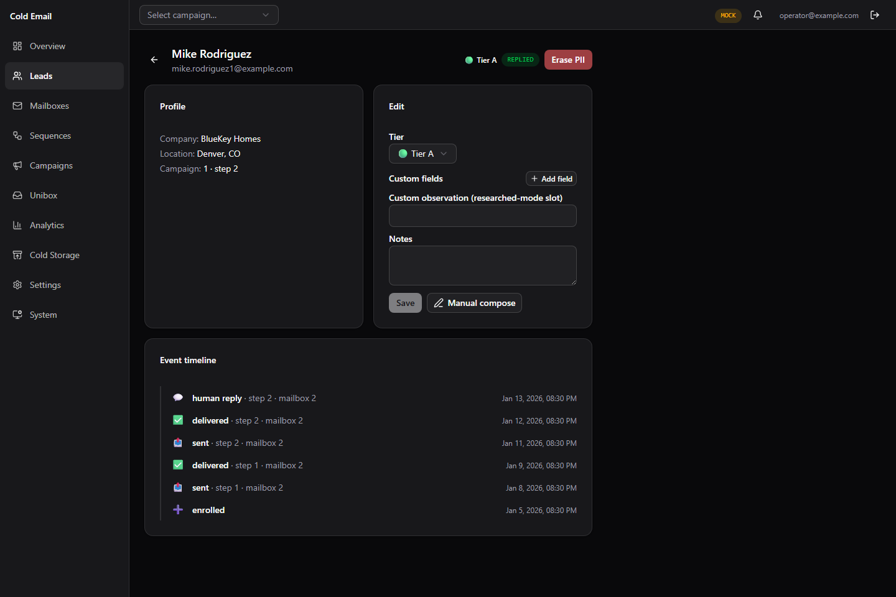

### 8.6 Event timeline

The newest event appears first. Events include enrollment, send, inferred delivery, soft/hard
bounce, human/automatic reply, unsubscribe, meeting, deal outcome, sentiment tag, and reply
disposition. Step and mailbox identifiers appear where relevant.

The timeline is history, not an editable activity log.

### 8.7 Suppression banner and removal

A suppressed lead is excluded globally. **Remove suppression** requires typing the exact email.
Use this only for a verified false positive. Removing the suppression does not erase historical
unsubscribe or bounce events and creates an audit alert.

Never remove suppression merely to retry an opted-out person.

### 8.8 Erase PII

**Erase PII** requires typing the exact email and permanently anonymizes personal profile data,
matching import/inbox data, and related alert PII. Non-identifying event lineage remains so the
ledger can still reconcile. Backups age out under retention; an old-backup recovery must replay
post-backup erasures before service resumes.

This is not an undoable archive action. Use it only for a genuine privacy/erasure request.

### 8.9 Personalized Copy

Personalized Copy saves subject/body for sequence use; it never sends directly.

1. Choose **Unassigned Source** to edit reusable global source copy, or choose a Campaign and one
   of its Personalized Steps to edit the independent campaign snapshot.
2. Review import provenance, readiness, preview, and copy-risk checks.
3. Use **Save Draft** while editing. Any content edit resets readiness to **needs review**.
4. Use **Mark Ready** only when both subject and body are valid and final.
5. Use **Copy from Source** to create or explicitly replace an unsent campaign-step snapshot.

Personalized Step 1 must be ready before enrollment. Later personalized steps can be prepared after
enrollment, but a due step without ready copy holds only that lead and raises a blocker. There is no
template or Auto Observation fallback for a personalized step. Copy becomes read-only after send.

All delivery happens through the scheduler, which appends the compliance footer and enforces copy
checks, suppression, reply stopping, recontact rules, pacing, caps, send windows, mailbox pinning,
threading, transport confirmation, and event logging. The old Manual Compose screenshot below is a
legacy production reference and does not represent the migration 0019 candidate.

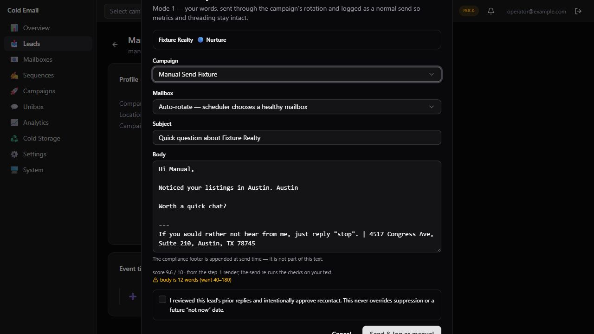

## 9. Mailboxes

Mailboxes are global across campaigns.

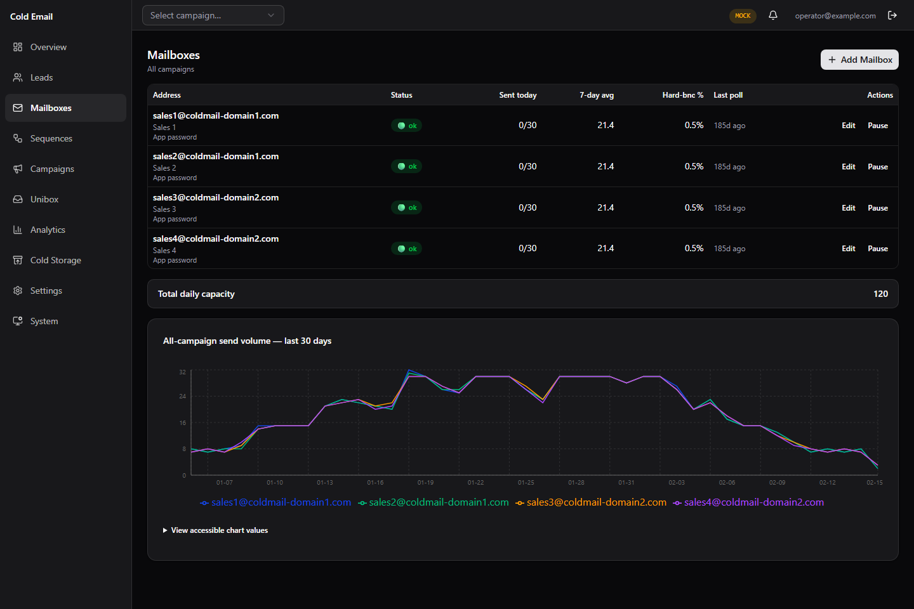

> **Current OAuth controls:** the fleet now shows `Google OAuth connected`, `Google OAuth`, or
> `App password` under each address. OAuth rows expose **Connect Google**, **Reconnect Google**, or
> **Disconnect** according to their state. The representative screenshot predates those labels.

### 9.1 Mailbox table

Columns show sender address/name, health status, sent today versus effective cap, seven-day average,
hard-bounce percentage, last successful poll, and actions. Total daily capacity sums effective caps
across the listed mailboxes.

The effective cap can be lower than the configured daily cap after a reduced-cap resume.

### 9.2 Add a mailbox

Choose **Add Mailbox** and configure:

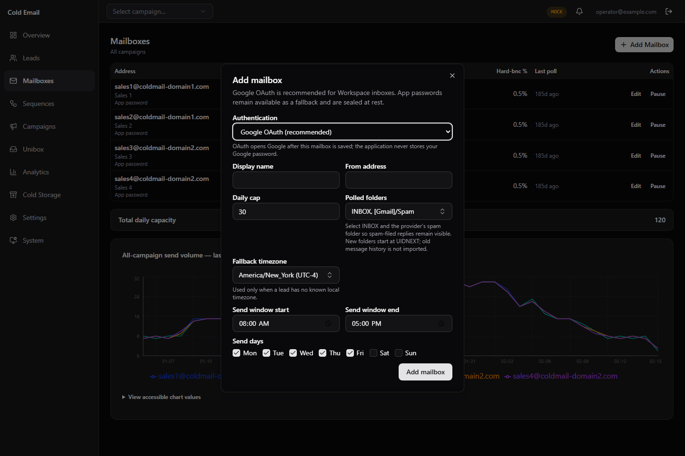

> **Current dialog:** an **Authentication** selector now appears first and defaults to **Google
> OAuth (recommended)**. Selecting **App password** reveals the SMTP host/port, IMAP host/port, and
> password fields shown in this representative screenshot. OAuth never asks for the Google account
> password.

- **Display name:** sender identity shown to recipients.
- **From address:** actual mailbox address.
- **Authentication:** choose **Google OAuth** for a Workspace Gmail inbox or **App password** for
  the existing credential flow.
- **SMTP host/port:** outbound server connection.
- **IMAP host/port:** inbound reply/bounce connection.
- **App password:** required only for app-password authentication; sealed at rest and never shown
  again.
- **Daily cap:** maximum accepted sends per mailbox-local day, subject to the global guardrail.
- **Polled folders:** provider-discovered multi-select, at minimum `INBOX`; refresh discovery after
  provider-side folder changes.
- **Fallback timezone:** searchable IANA timezone used when a lead's local timezone cannot be
  derived.
- **Send-window start/end and weekdays:** mailbox hours evaluated in the recipient's timezone.

The Google OAuth form defaults to `smtp.gmail.com:587`, `imap.gmail.com:993`, `INBOX,
[Gmail]/Spam`, a cap of 30, weekdays, 08:00–17:00, and the application's default timezone. These are
conveniences, not volume recommendations. App-password mode exposes editable provider hosts and
ports. Ports must be 1–65,535, at least one polling folder and one send weekday are required, and
the cap must be at least 1 and no higher than the current global mailbox-cap guardrail.

For Gmail, normally poll `INBOX, [Gmail]/Spam`. Other providers may call the folder `Junk` or
`Junk E-Mail`. Folder names are provider-specific.

For Google OAuth, creating the mailbox requires no password and initially saves it as
`setup_required`, which the scheduler cannot select. Choose **Connect Google**, complete consent
with the exact Workspace account matching the mailbox address, and return to the application. A
different Google account is rejected. The application stores only the encrypted refresh token;
short-lived access tokens stay in memory. The production Google client must be configured by the
Workspace administrator before the button can start authorization.

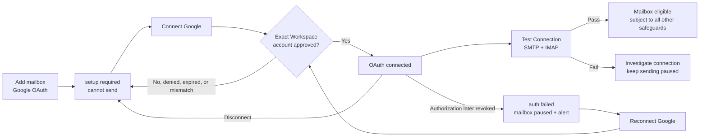

The authentication type is fixed after mailbox creation. If the wrong type was chosen before any
real use, create the correct mailbox record rather than expecting **Edit** to convert its credential
model. Do not use **Disconnect** as a routine pause; it removes authorization and returns the row to
`setup_required`.

When a folder is added through the UI/API, its cursor starts at the folder's current position. Old
history is not ingested. Never edit folder arrays directly in the database because that bypasses
cursor seeding and can ingest years of third-party mail.

### 9.3 Edit and test connection

Choose **Edit**. For an app-password mailbox, leave the password blank to retain the sealed
credential; entering one replaces it. OAuth mailboxes instead offer **Reconnect Google** and
**Disconnect** actions on the mailbox row. Disconnect revokes/removes authorization and returns the
mailbox to `setup_required`; it cannot send until reconnected. **Discover folders** refreshes the
provider's real folder list and special-use roles. **Test Connection** verifies SMTP and IMAP for
either authentication type, reports per-selected-folder existence, and reports round-trip time when
available. A folder verified as nonexistent cannot be saved.

Testing the connection confirms authentication/connectivity. It does not send a campaign email,
prove inbox placement, or prove the account is warmed.

### 9.4 Pause and resume

**Pause** removes an `ok` mailbox from new sending. Unstarted work rotates to other healthy
mailboxes. A conversation that has already sent from this mailbox remains pinned and waits; it is
not rerouted because that would break threading.

**Resume** returns a manually paused mailbox to service. Auto-paused failure panels normally offer
**Resume at 50%**, which sets a temporary reduced effective cap. The reduced cap clears after seven
consecutive clean days with no hard bounces.

### 9.5 Failure panels

- **Authentication failed:** enter a new app password or choose **Reconnect Google**. Revoked or
  expired OAuth authorization pauses the mailbox and raises an alert. Scheduled follow-ups remain
  queued.
- **IMAP stale:** replies and opt-outs may be invisible. Retry, verify folders, and do not resume
  risky sending until polling is current.
- **Auto-paused:** review the alert's bounce windows and recent list source; resume at reduced cap
  only after correction.
- **Provider blocked:** leave paused while investigating throttling or provider policy.

### 9.6 Volume chart

The chart shows 30 days of sends by mailbox across all campaigns. A rotation-imbalance warning
appears when one healthy mailbox's average is substantially higher than another's. Investigate cap,
status, and thread-pinning differences before increasing volume.

## 10. Sequences

A sequence defines what is sent, when it is sent, how variants rotate, and whether follow-ups stay
in thread. Every human reply stops the sequence; this safety rule cannot be disabled.

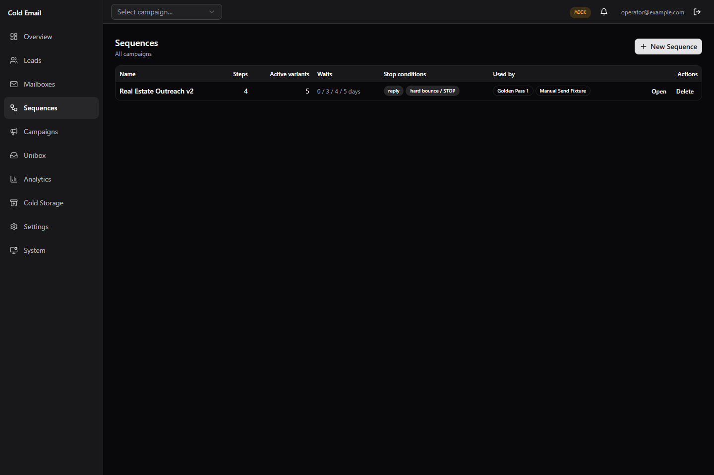

### 10.1 Sequence list

The list shows name, number of steps, active variants, wait pattern, stop conditions, and campaigns
using the sequence.

**Delete** requires typing the sequence name and succeeds only when no campaign, event, or sent
content references remain. A sequence with history is retained.

### 10.2 Create or edit a sequence

Choose **New Sequence** or open an existing sequence.

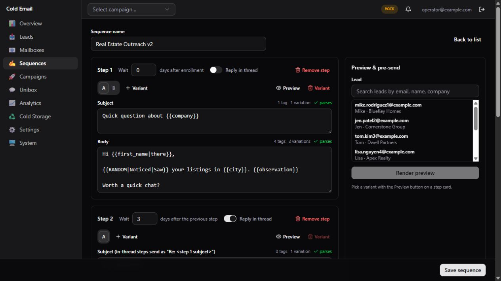

For each step:

- **Wait:** step 1 waits after enrollment; later steps wait after the previous send. Range is 0–90
  days.
- **Reply in thread:** later sends use `In-Reply-To`/`References` and `Re: <step-1 subject>`.
- **Subject and body:** plain-text templates.
- **Variants:** active variants rotate; labels default A, B, C, and continue alphabetically.
- **Preview:** selects this saved variant for lead-specific rendering.
- **Remove:** removes an unsent step/variant; sent history may force retirement instead.

At least one step and one variant per step are required. Empty subjects or bodies block saving.

### 10.3 Template grammar

Merge tags:

```text
{{first_name|there}}
{{company|your team}}
{{market|your area}}
{{custom_observation|something relevant to your work}}
{{any_custom_field|fallback}}
{{sequence.competitors|other tools}}
{{sequence.offer_name|the service}}
{{sender_physical_address}}
```

- The field is used when non-empty; otherwise the fallback is used.
- A missing field without a fallback is fatal and blocks sending.
- `market` derives from lead state where possible.
- `sender_physical_address` comes from Compliance settings.
- Unknown custom fields are fatal unless a fallback resolves the missing value.
- `sequence.*` values are reusable copy variables. Define defaults in the Sequence Builder and,
  while a campaign is still draft, optionally override them on the campaign detail page.
- Sequence-variable keys use lowercase letters, numbers, and underscores. Their values are literal
  strings—even multiline values—and are not recursively parsed as merge tags or spintax.
- On first campaign activation, `campaign override → sequence default` is resolved and frozen.
  Later sequence edits do not change an active campaign's snapshot.
- Use `\{\{` when literal opening braces are needed.
- Nested tags are unsupported.

Spintax:

```text
{{RANDOM|Hello|Hi|Good morning}}
```

Each spintax tag needs at least two options. Picks are deterministic for an enrollment, step, and
variant, so a retry reproduces the same wording. The UI shows the total variation count across
subject and body.

### 10.4 Step content and tier behavior

| Content/tier | Behavior |
|---|---|
| Personalized step | No variants; scheduler loads the ready lead/campaign/step subject and body. |
| Template step + Tier A | Uses `custom_observation` first, with the existing Auto Observation fallback warning. |
| Template step + Tier B | Uses the campaign Auto Observation field/rules/default. |

For Auto Slot, configure one **Auto Observation field** on the draft campaign—for example `state`,
`city`, `industry`, or another imported custom field—then add exact-match rules plus a required
`default`. Matching trims whitespace and ignores case. A blank/missing lead value uses `default`.
Researched mode first prefers the lead's own `custom_observation`, then falls back to the matching
campaign rule; Auto mode uses the campaign rule directly. Activation is blocked when a template
uses the Auto Slot but the field, rules, or default are invalid.

#### Choosing the approach for different lead types

The sequence decides which steps are Template and which are Personalized. Tier controls only how a
Template step resolves its observation; it does not decide whether a personalized email sends.

| Lead group | Recommended approach | What to prepare |
|---|---|---|
| Any lead receiving an individual opener or later individual email | Personalized sequence step | Import or edit ready subject/body for that exact campaign step |
| A — leads where one researched fact matters on template steps | Template step, researched behavior | Add a useful `custom_observation`; the campaign rule can serve as a warning fallback |
| B — broader qualified segment | Template step, Auto behavior | Use reliable common fields and a campaign Auto Observation that remains truthful for the segment |
| A distinct industry, persona, pain, offer, or language | Separate sequence and usually a separate campaign | Write a message and follow-up cadence designed for that audience; do not force unrelated groups through generic variants |
| A copy experiment for the same audience and offer | Another active variant in the same step | Change one meaningful idea at a time so Analytics can compare variants coherently |
| Rested completed leads receiving a genuinely new angle | New sequence in a Pass-2 campaign | Change the proposition/content enough to pass the content-hash guard; do not resend the old sequence |

The **New campaign** dialog displays fixed Tier A = Researched and Tier B = Auto behavior. While the
campaign remains draft, configure Auto Observation rules, sequence-variable overrides, and ramp
stages. First activation freezes those campaign settings permanently.

### 10.5 Live validation and copy-risk score

Template fields validate after a short pause and show token count, variation count, parse status,
and offsets for errors.

Preview checks include:

- invalid/missing merge tags — fatal;
- invalid or nested spintax — fatal;
- URL in step 1 — fatal; URLs in later steps warn;
- missing compliance address or opt-out text — fatal;
- HTML/image markup — fatal;
- duplicated footer text — warning;
- subject over 60 characters — warning;
- body outside 40–180 words — warning;
- copy-risk phrases, excessive all-caps, or multiple exclamation marks — warnings; and
- missing lead-specific personalization — warning.

The score is a transparent local writing rubric, not a spam-filter prediction or inbox-placement
guarantee. Subject-line risk phrases are weighted more heavily. Current flagged phrases include
common cold-email clichés such as “quick question,” “circling back,” “touching base,” “reaching
out,” “15 minutes,” “per my last email,” and promotional claims such as “guaranteed results,”
“risk-free,” or “special offer.”

### 10.6 Preview panel

Save first, then select a variant's **Preview**, search for a representative lead, select it, and
choose **Render preview**.

Choose **Sequence defaults** or a specific campaign context. The panel shows the exact
saved-template render, locked compliance footer, score, warnings, and fatal errors. Expand
**Resolution details** to inspect lead values, the matched observation rule, sequence-variable
sources, fallbacks, and deterministic spintax choices. Unsaved edits are not included; save and
render again. Test multiple leads, including missing-name and missing-custom-field cases.

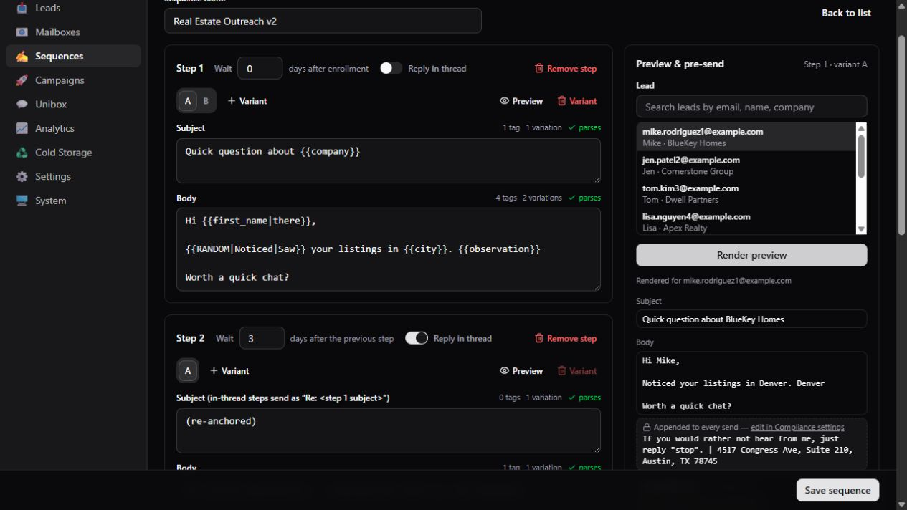

### 10.7 Editing a sequence with history

Once sends exist:

- sent steps cannot be deleted or renumbered in ways that rewrite history;
- removed variants are retired rather than erased;
- analytics continues to show sent manual/bespoke variants as read-only history; and
- content hashes continue protecting second-pass recycling.

## 11. Campaigns

A campaign combines one sequence, tier-to-effort rules, ramp and permanent daily enrollment caps,
an optional reserved lead pool, and enrolled leads.

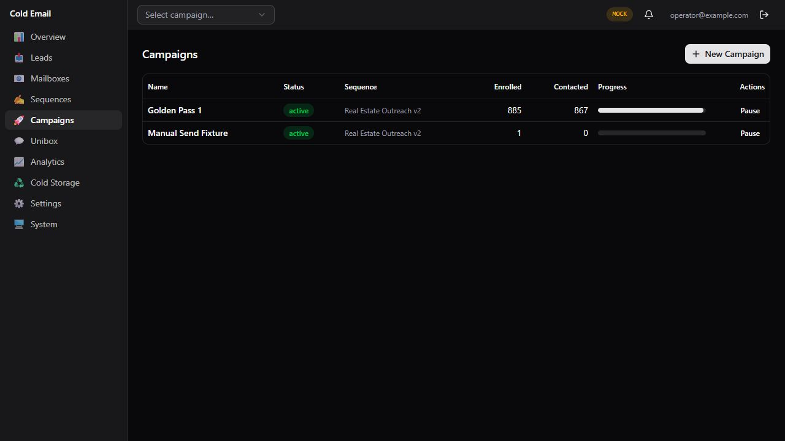

### 11.1 Campaign list

The list shows status, sequence, enrollment/contact counts, progress, and the next safe status
action. A “Pass 2” badge identifies a campaign created through recycling.

Primary actions:

- draft → **Activate**;
- active → **Pause**;
- paused → **Resume**.

Activation by itself does not create leads, but any already-enrolled due work becomes eligible on
the next scheduler tick.

### 11.2 Create a campaign

Choose **New Campaign** and set:

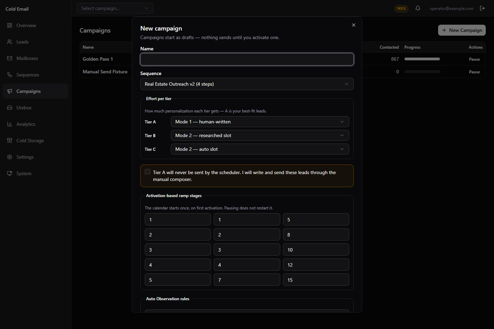

- **Name**;
- **Sequence**;
- initial ramp settings; and
- the permanent daily enrollment cap that applies after the ramp ends.

Campaigns start as drafts. There is no human-written acknowledgement or direct-send mode.

On the draft campaign detail page, configure:

- fixed Tier A = Researched and Tier B = Auto behavior;
- staged new-enrollment caps;
- the Auto Observation field, exact-match rules, and required default; and
- sequence-variable campaign overrides.

These controls are editable only while the campaign is draft. First activation permanently freezes
them and records the ramp start. Pausing and resuming neither unlocks the configuration nor restarts
the ramp. The permanent daily cap may be lowered after activation as a safety action, but never
raised. Create a new campaign if the other design must change after activation.

New campaigns use this default schedule:

| Campaign day | Maximum new enrollments |
|---:|---:|
| 1 | 5 |
| 2 | 8 |
| 3 | 10 |
| 4 | 12 |
| 5–7 | 15 |
| After day 7 | Permanent daily enrollment cap, default 15 |

Custom stages must cover every day from 1 through the final ramp day exactly once, with no gaps or
overlaps. Global guardrails can refuse a stage cap that is too high or a schedule that ends too
early.

### 11.3 Campaign detail

The header provides **Activate, Pause, Resume, Archive, Delete,** and **Back to list** as applicable.

- **Archive** requires typing the campaign name and immediately stops future scheduling.
- **Delete** requires typing the name and works only when no event history or references remain.
  Campaigns with history cannot be deleted as though they never existed.

The page also includes catch-up status, a Tier-A manual-only warning, TODAY capacity/enrollment,
lead-pool management, auto-enrollment status/history, state breakdown, and configuration. Drafts
show editable personalization/ramp settings; activated campaigns show the frozen configuration and
first-activation time.

### 11.4 Capacity calculation

Suggested new enrollment capacity is approximately:

```text
healthy mailbox effective capacity
− sends already made today
− follow-ups due today
− unsent Step-1 openers already reserved for today
bounded by the current ramp stage or permanent daily campaign cap
bounded by available pool leads when the campaign is pool-backed
```

Follow-ups are reserved before new openers. A high mailbox cap or allowed configuration is not
evidence that the volume is safe for reputation.

### 11.5 Enroll next N

Enrollment into an active campaign can result in sends on the next scheduler tick.

The count-based picker excludes suppressed/erased leads, Nurture and Untiered leads, prior human
repliers, concurrent active enrollments, duplicate campaign enrollments, recontact holds,
content-hash conflicts, and candidates lacking ready Personalized Step 1 copy. It orders Tier A →
Tier B. Legacy global campaigns then use oldest import first; pool-backed campaigns use allocation
order. An empty pool reports no eligible pooled leads and never falls back to the global list. If
fewer eligible leads exist, the result reports precise skipped/blocker buckets.

### 11.6 Lead pools and automatic daily enrollment

A campaign lead pool is a reservation list, not an enrollment list. Pool entries have these states:

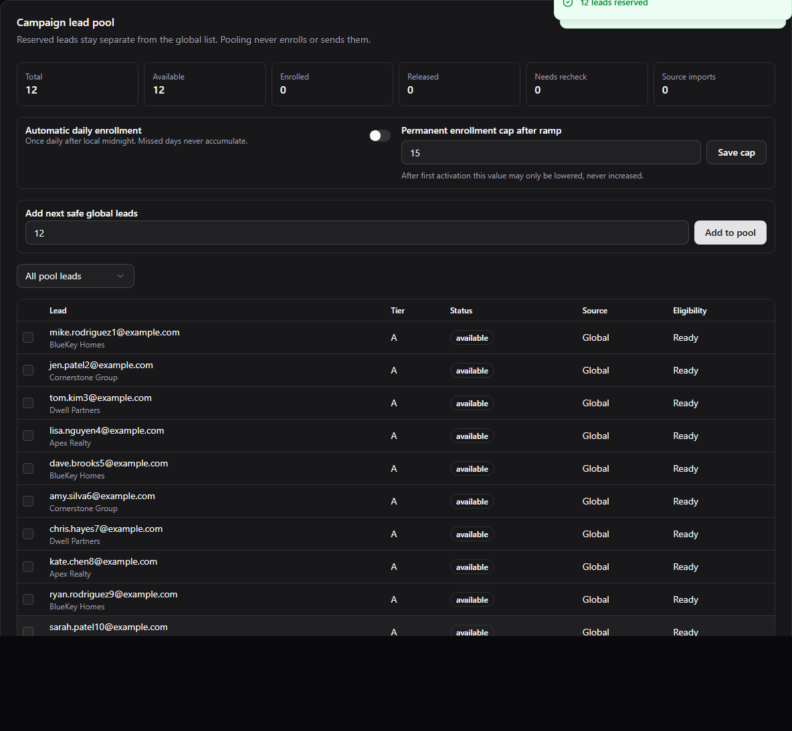

- **Available:** reserved for this campaign and eligible to be considered.
- **Enrolled:** consumed into an enrollment; it cannot be released or reassigned.
- **Released:** historical record that the reservation was returned or moved.

While a campaign is draft or paused, the pool panel can add the next N safe global leads, release
selected available entries, or atomically reassign selected entries to another draft/paused
campaign. Summary cards show total, available, enrolled, released, temporarily ineligible, and
source-import counts. Once a campaign receives a pool allocation it stays pool-backed permanently.

**Automatic daily enrollment** is optional and off by default. It requires a pool-backed campaign.
You may arm a draft, but it does nothing until activation. Enabling it on an active campaign shows
an acknowledgement and immediately uses only today's remaining safe capacity. Paused, draft, and
archived campaigns are skipped; disabling it does not remove existing enrollments.

After application-local midnight, the first worker check performs at most one daily allocation.
Retries, restarts, concurrent workers, and daylight-saving changes cannot run that date twice. If
the server was offline for three days, it runs only today's allowance after restart—the three missed
allowances do not accumulate. With several enabled campaigns, available shared mailbox room is
distributed one lead per campaign per pass, continuing after the last-served campaign next time.
The run-history table records the trigger, date, result, and failures.

On phones, the same pool controls and lead rows become touch-friendly stacked cards.

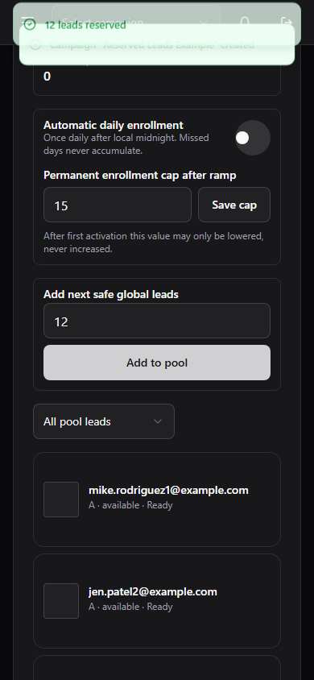

Example: four healthy mailboxes provide 40 shared sends today. Ten sends already occurred, 12
follow-ups are due, and 3 Step-1 openers are already reserved, leaving 15 shared slots. Campaign A
has 20 pool leads and 10 cap remaining; Campaign B has 20 pool leads and 8 cap remaining. The fair
allocator can enroll 8 for A and 7 for B (one per campaign per pass) rather than letting A consume
all 15. Those enrollments reserve capacity; the scheduler still applies each mailbox's send window
and pace gap before any message is actually sent.

### 11.7 Completion report

When nothing remains `NEW` or `ACTIVE`, the completion report shows mutually exclusive outcomes:

- replied positive;
- replied neutral/negative;
- unsubscribed;
- hard bounced; and
- completed without reply.

The rows must reconcile to total enrollment. The report separately shows event-based rates, which
can overlap, and offers **Recycle cold storage** or **Import fresh leads**.

## 12. Unibox

Unibox is the operator's reply work queue across campaigns.

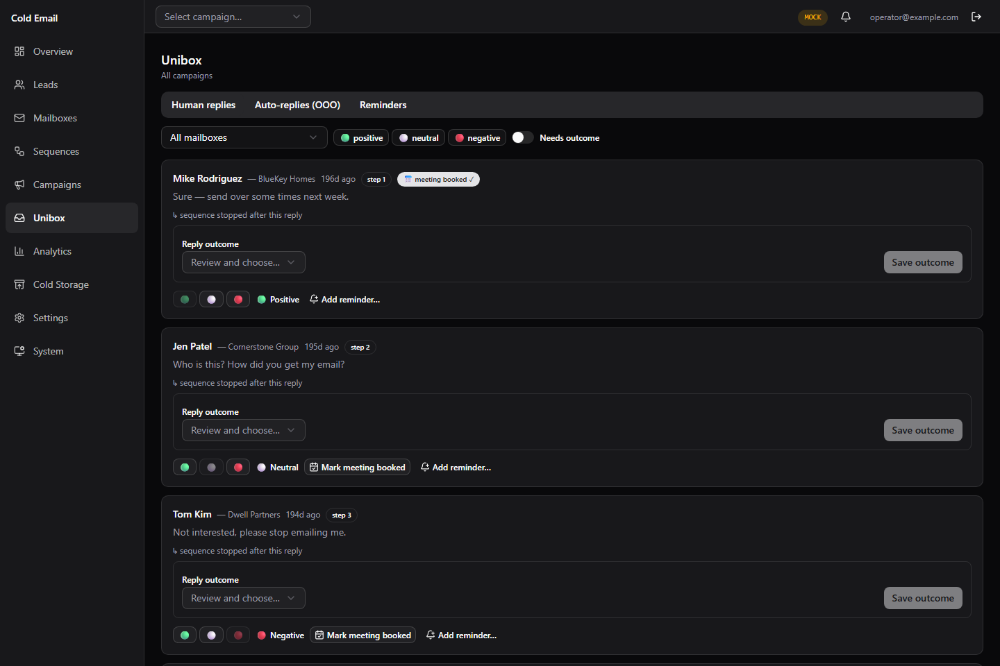

### 12.1 Filters and tabs

- **Human replies:** real responses that stop the sequence.
- **Auto-replies (OOO):** automatic responses that do not count as human engagement and normally
  allow the sequence to continue.
- **Reminders:** operator follow-up tasks grouped into Due today, Upcoming, and Overdue.
- **Mailbox filter:** restricts the feed to one receiving mailbox.
- **Sentiment filters:** positive, neutral, negative.
- **Needs outcome:** human replies without a saved disposition.

### 12.2 Reply card

The card shows lead, company, time, step, snippet, meeting badge, sequence-stop status, and automatic
unsubscribe status. Clicking the card opens the thread view with sent message IDs/timestamps and
the captured reply body.

### 12.3 Mandatory reply stopping

Every detected human reply stops later steps immediately, even if the reply says “not interested,”
“not handling this,” or something ambiguous. It does not need to contain STOP.

An automatic OOO message is different: it is labeled auto-reply, does not count as a human reply,
and normally does not stop the sequence.

### 12.4 Reply outcomes

Every human reply should receive one outcome:

| Outcome | Meaning | Suppression/recontact effect |
|---|---|---|
| Interested | Genuine interest | Not suppressed; any later cold recontact still requires explicit acknowledgement |
| Not interested | Declines outreach | Immediately globally suppressed |
| Not now | Timing objection | Requires a future do-not-contact-before date; not suppressed, but blocked until then |
| Wrong person | Recipient is not appropriate | Immediately globally suppressed |
| Referred me | Recipient referred another person | Original sequence stays stopped; not automatically suppressed |
| Explicit opt-out | Clear request not to be contacted | Immediately globally suppressed |
| Other | None of the above | Not automatically suppressed; sequence remains stopped |

Saving a suppressive outcome appends both the disposition and unsubscribe/suppression facts
atomically when needed.

Recontact after **any** prior human reply requires all replies to have outcomes and an explicit
recontact acknowledgement. A future “not now” date blocks recontact. Suppression can never be
overridden by that acknowledgement.

### 12.5 Sentiment

Tag a human reply positive, neutral, or negative. The latest human tag becomes effective and feeds
analytics. If AI sentiment suggestion is configured, it appears only as a suggestion until the
operator tags it. AI failure never blocks reply ingestion.

Sentiment alone does not equal an outcome and negative sentiment alone does not necessarily
suppress. Save both the appropriate outcome and sentiment.

### 12.6 Meeting booked

**Mark meeting booked** appends a durable meeting event and updates campaign analytics. It does not
change terminal state.

### 12.7 Reminders

Human-reply Snooze was replaced with explicit in-app reminders. Create a reminder from a reply by
choosing a calendar date and optional note. Saving **Not now** automatically creates or updates a
reminder for its do-not-contact date.

Reminders do not send a message, restart a sequence, or grant permission to contact. Completing or
dismissing one only clears the operator task. The separate do-not-contact date and global
suppression rules still decide whether future contact is permitted. Older replied-enrollment
Snooze dates are migrated into reminders; legacy active-enrollment scheduling holds retain their
old scheduler meaning, but the Unibox no longer creates them.

### 12.8 Automatic versus tag-only opt-out detection

In **Automatic** mode, recognized opt-out wording immediately records unsubscribe and global
suppression. The card says auto-unsubscribed.

In **Tag only** mode, detection does not suppress automatically. A negative human reply exposes an
**Unsubscribe lead** action. Use it whenever the message is an opt-out. Tag-only mode places more
compliance responsibility on the operator.

## 13. Analytics

Analytics is scoped to the selected campaign and contains four tabs.

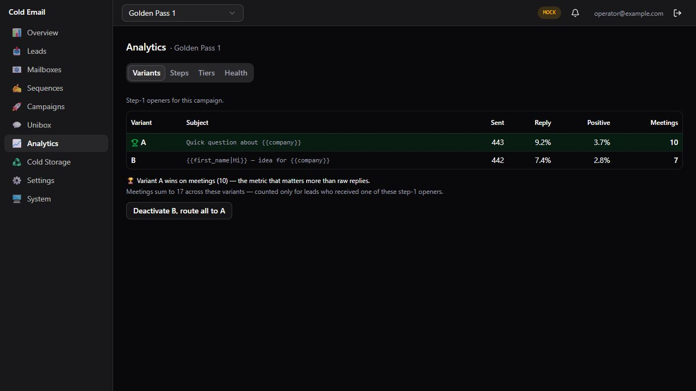

On phones, every analytics table becomes a stacked card, tabs remain scrollable, and chart values
have an accessible text view.

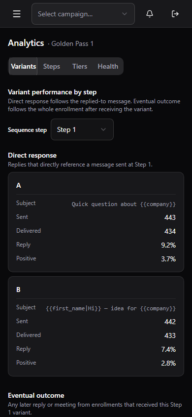

### 13.1 Variants

Choose any sequence step from the step selector. The screen separates two questions:

- **Direct response:** how many messages at the selected step were sent/delivered, and how many
  replies directly referenced that step's message. A reply received before delayed delivery
  confirmation still counts as contacted, so the rate cannot exceed 100% for that reason.
- **Eventual outcome:** among all enrollments that received the selected variant, how many later
  replied, became positive, or booked a meeting—even when the reply referenced a later step.

The recommended winner uses eventual meetings first and eventual positive rate second. If both are
equal, the screen reports a tie instead of choosing arbitrarily. Under 300 sends per automated
variant is marked a small sample.

**Deactivate variant** retires a losing active variant for future sends. Historical sends remain
visible. Manual/bespoke variants are read-only, and the system refuses to deactivate the final
active automated variant for a step.

### 13.2 Steps

Shows delivered count, positive replies, positive rate, and verdict for each step. Fewer than 200
deliveries is a small sample. A step below 0.5% positive rate with sufficient volume is labeled
weak. The footer reconciles per-step positives to the campaign total.

Treat automated “remove weak step” guidance as analysis, not an instruction to rewrite sent
history. Sequence edits with history are constrained.

### 13.3 Tiers

Shows contacted, reply rate, positive rate, meetings, and effort mode by the tier captured at
enrollment. Reconciliation compares tier totals with campaign totals.

When replied Tier-C leads exist, **Promote engaged Tier-C → Tier B** updates their current lead tier
for future campaigns. It does not alter past enrollment analytics.

### 13.4 Health

Shows 30-day sparklines and arithmetic for sent, delivered, reply rate, hard-bounce rate, and
unsubscribe rate.

Displayed watch thresholds include:

- hard-bounce rate above 4%; and
- unsubscribe rate above 5%.

Additional watch rules can flag a substantial 30-day reply-rate drop or an increasing 14-day
unsubscribe trend. Pause and investigate trends; do not “solve” them by increasing volume.

### 13.5 Why numbers may not add up like a funnel

- Terminal outcome rows are mutually exclusive and should sum to enrollments.
- Event rates overlap: one person can reply, book a meeting, and later unsubscribe.
- Contacted is not identical to sent.
- Delivery is delayed by the configured confirmation window.
- Tier analytics uses enrolled tier, not the lead's current tier.

## 14. Cold Storage

Cold Storage lists unsuppressed leads whose enrollment completed without reply.

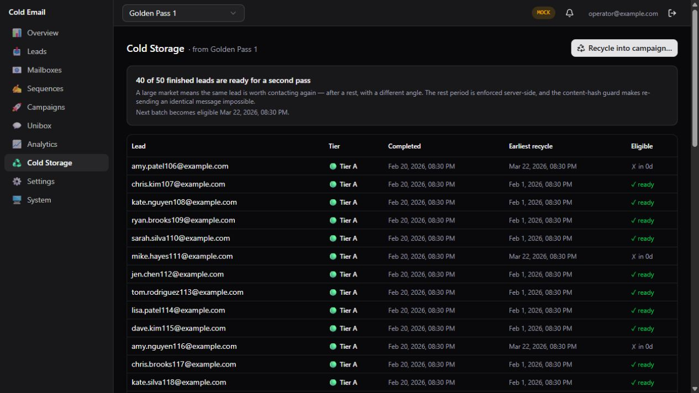

Each row shows completion time, earliest recycle date, and eligibility. The wait is
`cold_storage_rest_days` from terminal time and is enforced server-side.

### Recycle into campaign

1. Create a **draft** target campaign using a genuinely different sequence/angle.
2. Choose **Recycle into campaign** from Cold Storage.
3. Select at least two completed source campaigns and one draft target.
4. Choose **Preview eligibility**. Review unique leads, cross-source duplicates, rest-period,
   nurture, suppression/recontact, existing-target, and prior-content exclusions plus per-source
   contributions.
5. Choose **Confirm recycle** only after the preview makes sense.

Confirmation recomputes every rule, so a lead who becomes suppressed after preview is safely
skipped. Each eligible lead appears only once in the target even if present in multiple sources.
The original enrollments and event history remain untouched, the target stays draft, and every
qualifying source relationship is recorded.

If target active-variant content matches content a lead already received, that lead is skipped and
reported as a prior-content conflict; the duplicate message is never resent. Other currently
eligible leads can still commit atomically.

Prior human repliers and suppressed leads are not ordinary cold-storage candidates.

## 15. Settings

Switching tabs with unsaved changes prompts before discarding them.

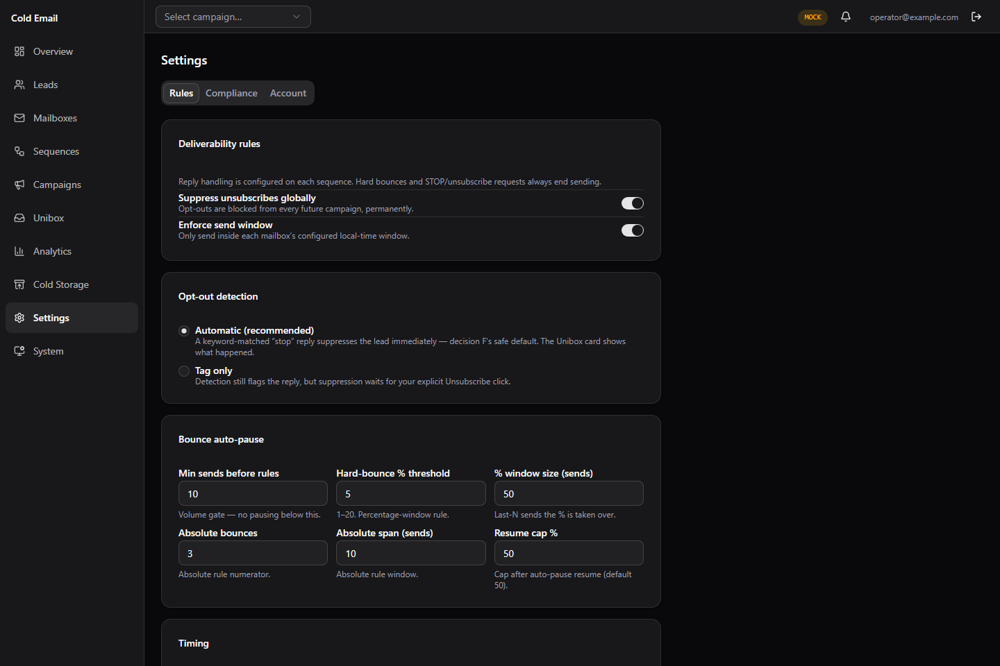

### 15.1 Rules → deliverability rules

- **Suppress unsubscribes globally:** opt-outs block every future campaign. Keep enabled.
- **Enforce send window:** sends only inside each mailbox's configured recipient-local window.
  Keep enabled for real operation.

Human-reply stopping is owned by the sequence and mandatory. Hard bounces and STOP/unsubscribe
always end sending.

### 15.2 Rules → opt-out detection

- **Automatic (recommended):** recognized opt-out wording immediately suppresses.
- **Tag only:** requires explicit operator unsubscribe action.

### 15.3 Rules → bounce auto-pause

| Setting | Meaning |
|---|---|
| Min sends before rules | Volume gate before percentage-based evaluation |
| Hard-bounce % threshold | Percentage threshold over the configured window |
| % window size | Number of recent sends used for the percentage rule |
| Absolute bounces | Bounce count that triggers the short-window absolute rule |
| Absolute span | Recent-send span for the absolute rule |
| Resume cap % | Temporary percentage of normal cap after resuming |

The absolute rule can protect at low volume. Do not weaken thresholds to keep a bad list moving.

### 15.4 Rules → timing

| Setting | Meaning and caution |
|---|---|
| Scheduler tick | How often due work is evaluated; faster ticks do not bypass pacing |
| IMAP poll | Reply/bounce detection frequency |
| Stale poll | Age after which missing IMAP success becomes a safety failure |
| Delivery confirm | Delay from sent to inferred delivered when no bounce arrives |
| Send jitter | Variation around mailbox pace gap |
| Soft-bounce retries | Retries before the enrollment becomes bounced |
| Cold-storage rest | Wait before a completed lead can be recycled |
| Default timezone | Fallback when lead state cannot map to a local zone |

Validation ranges are: scheduler 1–60 minutes; IMAP poll 1–120 minutes; stale-poll and delivery
confirmation 1–72 hours; soft retries 0–10; jitter 0–100%; and cold-storage rest 0 days or more.
Choose a valid IANA timezone such as `America/New_York` or `UTC` from the searchable selector. Both
the browser and server reject invalid names, so a mistyped timezone cannot be saved.

After the first send exists, `delivery_confirm_hours` is immutable. This preserves replay-stable
completion times. Attempting to change it is refused by both application logic and the database.

### 15.5 Rules → launch guardrails

- **Max mailbox daily cap:** mailbox records cannot be saved above this ceiling.
- **Max campaign enroll/day:** ramp-stage and permanent campaign caps cannot exceed this ceiling.
- **Min ramp days:** new campaigns cannot use a shorter ramp; `0` disables enforcement and is not
  launch-ready.

These are configuration ceilings, not recommended volumes. A permitted value may still be unsafe
for a new or damaged mailbox.

The two maximum-cap fields accept 1–500. Minimum ramp days accepts 0–90; zero deliberately disables
that protection and is reported as not launch-ready.

### 15.6 Compliance

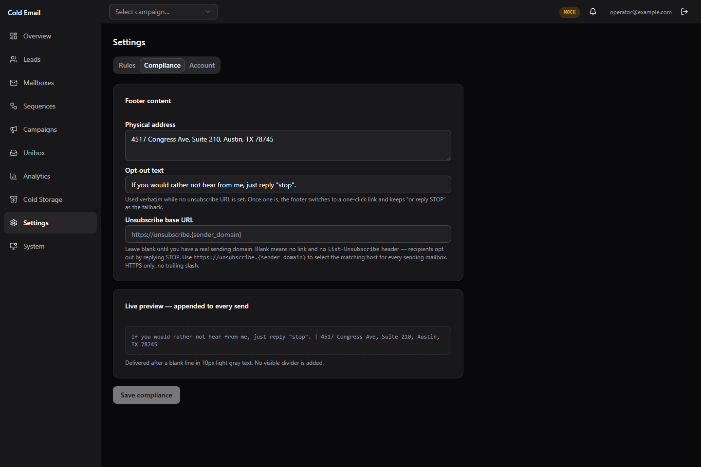

> **Current footer preview:** the visible em-dash divider shown in this representative screenshot
> has been removed. The current screen states that delivery uses a blank line followed by 10px light
> gray text with no visible divider.

- **Physical address:** legally valid business postal address appended to every send. Empty blocks
  all sending. Use a registered office, PO box, coworking address, or legitimate commercial mailbox
  if you do not want to publish a home address.
- **Opt-out text:** used verbatim when the public unsubscribe URL is dormant.
- **Unsubscribe base URL:** use `https://unsubscribe.{sender_domain}` in this deployment. The
  placeholder is replaced from each sending mailbox's domain, so mail from `sambhavpmtech.com` and
  `sambhavpmops.com` receives links on the corresponding unsubscribe host. A fixed HTTPS origin is
  also accepted; no trailing slash, query, or fragment is allowed.

When the base URL is blank, the app emits no unsubscribe link or `List-Unsubscribe` headers and the
footer instructs the recipient to reply STOP. When configured, every send receives an opaque token,
a body link, and the paired one-click headers while reply STOP remains available.

The live preview shows the canonical words but stays at an accessible interface size. The delivered
message is `multipart/alternative`:

- the HTML alternative places the footer after a 16px top gap, at `10px`, color `#767676`, and
  `line-height: 1.5`;
- the unsubscribe destination is linked behind the word **Unsubscribe**—normal HTML-capable email
  clients do not display the full token URL;
- the plain-text alternative shows the complete URL because plain text cannot hide a destination
  behind linked words; and
- both alternatives contain the same opt-out meaning and postal address after one blank line, with
  no `---` or em-dash divider.

Templates cannot remove or restyle this server-appended footer. It intentionally has no images,
tracking pixels, click tracking, external fonts, or complex HTML.

### 15.7 Account

Displays the single operator email and changes the operator password. Enter the current password
and a new password of at least eight characters. Use a unique strong password and store it in a
password manager.

## 16. System

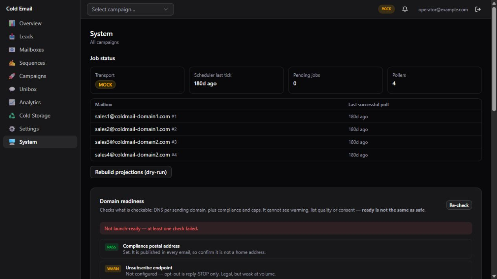

### 16.1 Job status

Shows:

- transport mode;
- scheduler's last completed tick;
- pending jobs;
- number of pollers;
- global send blockers; and
- each mailbox's last successful poll.

“Never” or stale timestamps require investigation before sending.

### 16.2 Rebuild projections — dry run

This replays the append-only event log and compares derived enrollment state with stored
projections. It writes nothing.

- `0 diffs` is the expected result.
- Any non-zero result is a correctness incident. Pause affected sending, preserve evidence, and
  diagnose before running a write rebuild.

### 16.3 Domain readiness

The panel checks what the application can observe, including sending-domain DNS, compliance,
mailbox health, conservative caps, ramp enforcement, and unsubscribe configuration.

Statuses:

- **PASS:** automated requirement observed.
- **WARN:** not proven or requires operator judgment.
- **FAIL:** launch blocker detected.
- **UNKNOWN:** the check cannot establish the answer; DKIM absence is unknown rather than a false
  failure because selectors cannot be enumerated reliably.

**Re-check** refreshes results. `No blocking failures` does not prove warming, consent, relevance,
list quality, reputation, or inbox placement.

### 16.4 Alerts history

Shows created time, kind, severity, raw details, open/acknowledged status, and acknowledgement
action. Use **Open only** to focus on unresolved alerts. History includes auto-pauses,
authentication failures, stale IMAP, backup/integrity failures, catch-up backlog, and job failures.

Record resolution outside the alert payload where your operating process requires an incident
record; acknowledgement itself does not store a narrative resolution.

### 16.5 Reply detection

This debug table shows every incoming message processed by IMAP and its classification:

- bounce;
- auto-reply;
- human reply; or
- unrelated.

Filter by mailbox or class. Columns show sender, subject, DSN status, matched enrollment/lead, and
resulting event IDs. Unmatched bounces and unrelated messages are still recorded for diagnosis.

The application never matches replies by subject alone. It uses `In-Reply-To` and `References`
against stored outbound message IDs.

## 17. Public unsubscribe experience

The two public hosts and the production `https://unsubscribe.{sender_domain}` template are active
for future sends:

```text
https://unsubscribe.sambhavpmtech.com/u/⟨opaque-token⟩
https://unsubscribe.sambhavpmops.com/u/⟨opaque-token⟩
```

Opening only `https://unsubscribe.sambhavpmtech.com/` or
`https://unsubscribe.sambhavpmops.com/` intentionally returns 404. These are not websites with a
homepage; the host gateway accepts only a valid `/u/...` application path. Configuration does not
modify messages that were already sent.

When active:

1. Each send receives a unique opaque unsubscribe token; only its hash is stored.
2. Opening the link with `GET` displays a confirmation page and does **not** unsubscribe. This
   prevents security scanners from opting people out by prefetching.
3. Selecting **Unsubscribe me**, or a supported mail client's one-click POST, records a global
   unsubscribe and suppression.
4. Repeating the action is idempotent and does not create duplicate facts.
5. Unknown/expired tokens show the same generic success wording and reveal no recipient data.

Offline and routing tests cover these mechanics, but the production Gmail body-link and RFC 8058
one-click behavior are not considered live-verified until the separately approved owner-address
canary is complete.

Never paste or log a recipient unsubscribe URL. The token is a capability.

## 18. What happens automatically

### 18.1 Scheduler tick

On each tick, the scheduler:

1. refreshes mailbox health and completion state;
2. calculates each healthy mailbox's local-day budget;
3. loads due active work oldest first;
4. respects snooze, send windows, caps, and pacing;
5. keeps follow-ups on their original mailbox;
6. rotates unstarted openers among healthy mailboxes;
7. re-checks suppression and reply state immediately before appending a send; and
8. accepts at most one message per mailbox in a tick.

Overlapping ticks are locked so they cannot double-send.

### 18.2 Pacing and never-burst behavior

Base pace gap is mailbox send-window minutes divided by effective cap, with configured jitter.
After downtime, overdue rows remain ordinary due work and drain oldest-first through the same
budgets. A catch-up alert appears when the backlog exceeds remaining daily capacity.

Increasing tick frequency does not make the scheduler ignore pace gaps.

### 18.3 Mailbox rotation and thread pinning

An opener chooses the healthy mailbox with the lowest used-cap ratio, then the least-recent sender
for ties. That mailbox is assigned atomically with the first successful send. Every later step stays
on it for correct threading.

Unstarted work has no assignment and can rotate around a failed mailbox. Started threads wait for
their original mailbox rather than silently changing sender.

### 18.4 Delivery confirmation

After SMTP acceptance, a delayed job appends `delivered` only if no soft/hard bounce for that step
has arrived. This is a practical inference, not proof that the message reached Primary inbox.

### 18.5 Soft and hard bounces

- Recipient-level permanent failure records hard bounce, ends the enrollment, and suppresses the
  lead globally.
- Temporary/4xx failure leaves work due and retries with backoff.
- A DSN soft bounce reschedules the same step; exceeding the retry limit makes the enrollment
  bounced.
- Authentication/permanent mailbox failures change mailbox health instead of blaming a lead.

### 18.6 Automatic mailbox protection

Auto-pause evaluates hard bounces over configured recent-send windows. Repeated provider throttle
responses can produce `provider_blocked`. Missing successful IMAP polls produces `imap_stale` and
pauses risky sends because unseen replies might exist.

### 18.7 IMAP polling and classification

The poller reads configured folders without moving messages or marking them seen. Folder UID
cursors and message IDs prevent duplicate event processing.

Classification order is bounce → auto-reply → human reply → unrelated. A malformed message is
recorded as unrelated with a parse error so one bad message cannot wedge the mailbox.

### 18.8 Opt-out matching

Automatic mode examines the unquoted beginning of a human reply for phrases such as STOP,
unsubscribe, remove me, take me off, opt out, or do not contact/email me. Bare “stop” uses stricter
context rules to avoid matching ordinary sentences such as “we should stop losing leads.”

### 18.9 Backups and integrity jobs

The production stack takes retained database backups and runs scheduled integrity checks. Backup
freshness and projection/self-check problems become alerts. A backup file existing is not enough;
restore drills must prove it can be used.

## 19. Safety, compliance, and data handling

Before importing or contacting leads:

- document the lawful basis or consent standard for every target jurisdiction;
- retain lead source, collection date, business relevance, and intended use;
- publish the required privacy notice for direct-marketing processing;
- verify that scraped or purchased data was lawfully collected and can be reused;
- screen every import against suppression; the application performs this when the suppression
  record is present;
- use accurate sender identity, routing, and non-deceptive subjects;
- include a valid business postal address;
- provide a clear opt-out and honor it globally;
- define retention, correction, erasure, and backup-erasure replay procedures; and
- review data-processing terms for enrichment, mailbox, hosting, and AI providers.

Application safeguards support these obligations but do not determine jurisdiction, lawful basis,
or whether a vendor's data rights are valid.

The product intentionally has no tracking pixel, click tracking, or tracking redirect.

## 20. Incident and troubleshooting guide

### “The production application is unavailable”

1. Confirm the browser address is exactly
   `https://sambhavpmtech.com/email-campaign/`.
2. Check whether the portfolio is also unavailable; this distinguishes host/proxy trouble from the
   application stack.
3. Do not repeatedly activate or resume actions when service returns.
4. Check System health, recent alerts, and backup freshness after recovery. Use the Oracle tunnel
   only if the operator deliberately invokes the rollback runbook.

### “Nothing is sending”

Check, in order:

1. Campaign is active and has active enrollments.
2. Sequence exists and templates have no fatal checks.
3. Tier-A work is not manual-only.
4. Compliance address is present.
5. At least one mailbox is `ok`.
6. Recipient-local send window is open and enforcement is enabled.
7. Daily/effective capacity is not exhausted.
8. Pace gap has elapsed.
9. Lead is not suppressed and has no prior undispositioned reply/recontact block.
10. System send blockers and alert history explain the current episode.

### “A lead replied but still received a follow-up”

1. Pause the campaign.
2. Confirm the incoming message appears as **human reply**, not OOO/unrelated.
3. Check Reply detection for message IDs, matched enrollment, mailbox folder, and event IDs.
4. Verify the relevant folder is polled and IMAP is current.
5. Check whether the follow-up had already been SMTP-accepted before the reply was processed; it
   cannot be recalled.

### “A lead said they are not interested”

The human reply already stops the sequence. Save **Not interested** as the outcome to add global
suppression. Tag sentiment separately. Do not rely on a negative sentiment tag alone.

### “Mailbox authentication failed”

Pause affected campaigns if replies may be missed. Enter a new provider app password or choose
**Reconnect Google**, test the connection, observe a successful poll, then resume conservatively.

### “IMAP is stale”

Do not assume replies are absent. Verify credentials and every provider-specific folder. Keep the
mailbox/campaign paused until a normal poll succeeds.

### “Hard bounces spiked”

Pause immediately. Separate recipient DSNs from provider/authentication failures, identify the
source/import batch, quarantine it, and verify that hard-bounced leads were suppressed. Resume only
after the cause is corrected and at reduced volume.

### “A spam complaint or informal do-not-contact message arrived”

Treat it as an opt-out even without the word STOP. Save **Explicit opt-out**, **Not interested**, or
**Wrong person** as appropriate and confirm global suppression. Pause the campaign if complaints
cluster.

### “Projection dry-run reports diffs”

Pause affected sending, preserve the evidence, and diagnose. A dry run does not repair anything.
Do not casually run a write rebuild or modify event history.

### Emergency campaign pause

Use **Campaign → Pause**. Closing a browser tab does not pause production. Confirm no new `sent`
events occur after the pause; messages already accepted cannot be recalled. Keep IMAP
polling operational when safe so replies and opt-outs continue to arrive.

For detailed incident records and recovery procedures, see
[18-incident-response-runbook.md](18-incident-response-runbook.md).

## 21. Pre-launch checklist

Do not send real prospect mail until every applicable item is complete.

### Infrastructure and authentication

- [x] Real sending domains are separate from the primary business domain.
- [x] SPF is published for each sending domain.
- [x] DKIM records are published for both Workspace domains; verify signing again with a received
  canary message before prospect mail.
- [x] DMARC is published with reporting addresses for both domains.
- [x] The production Internal Google OAuth client credentials are configured without exposing them.
- [ ] Reply inboxes exist, are secured, and have provider app passwords/OAuth as applicable.
- [ ] Mailboxes have completed a conservative warming period.
- [x] The production VPS, nightly logical backup, scratch restore drill, and five-backup Spaceship
  AutoBackup plan are ready.
- [x] Public HTTPS unsubscribe routing is configured and host-isolated; link/one-click behavior
  still needs the separately approved owner-address canary.

### Application

- [x] Spaceship is the production target and its transport is `LIVE`; Oracle is the paused rollback
  canary.
- [ ] Every mailbox passes SMTP and IMAP connection tests.
- [ ] `INBOX` and provider spam/junk folders are polled.
- [ ] Mailbox timezone, weekdays, hours, and conservative caps are correct.
- [ ] Send windows are enforced.
- [ ] Global cap guardrails and minimum ramp days are conservative.
- [x] The business postal address and sender-domain unsubscribe template are saved in production.
- [ ] Reconfirm the sender display name/address and rendered footer for the first connected mailbox.
- [ ] System domain readiness has no unexplained failures.
- [ ] Projection dry-run is zero-diff; self-check and backup freshness are clean.
- [ ] No unresolved auth, IMAP, backup, drift, or failed-job alerts exist.

### Leads and legal basis

- [ ] Lead source and collection date are recorded.
- [ ] Business relevance and intended use are documented.
- [ ] Jurisdiction-specific lawful basis/consent requirements are reviewed.
- [ ] Purchased/scraped data reuse rights are verified.
- [ ] List quality is independently verified; role-based and stale addresses are removed.
- [ ] Suppression screening is complete.
- [ ] Privacy notice, retention, correction, and erasure procedures are ready.

### Campaign and copy

- [ ] Sequence previews pass against representative leads and missing-data cases.
- [ ] No fatal render checks remain.
- [ ] Subjects are accurate and non-deceptive.
- [ ] Tier effort, Auto Observation rules, variable overrides, and ramp stages are correct before
  first activation; they cannot be edited afterward.
- [ ] Tier-A manual responsibility is understood.
- [ ] The first approved batch is deliberately small and named.
- [ ] Someone is available to monitor Unibox, bounces, alerts, and complaints.
- [ ] Emergency pause and incident ownership are clear.

## 22. Daily operating checklist

### Before sending starts

- Confirm the correct campaign in the global selector.
- Review the alerts bell and System open alerts.
- Confirm scheduler and poller freshness.
- Confirm healthy mailboxes, caps, and recipient-time windows.
- Review TODAY follow-ups and capacity before enrolling new leads.
- Confirm the approved cohort and volume.

### During the day

- Process every Unibox human reply and save an outcome.
- Tag sentiment and record meetings separately.
- Confirm opt-outs and informal do-not-contact requests are suppressed.
- Watch hard-bounce and unsubscribe trends.
- Pause immediately when a safety signal is unexplained.

### End of day

- Ensure no reply remains under **Needs outcome**.
- Reconcile campaign state and any auto-paused mailbox.
- Review acknowledged and open alert history.
- Confirm expected backup/integrity status.
- Record incidents, settings changes, approvals, and restoration details.

## 23. Glossary and quick reference

| Term | Definition |
|---|---|
| Alert acknowledgement | Marks an alert as seen; does not fix or delete it |
| Campaign | Sequence + effort/ramp configuration + enrolled leads |
| Contacted | Lead with inferred delivery or human reply |
| Content hash | Fingerprint used to prevent identical second-pass resend |
| Disposition | Operator-recorded business outcome of a human reply |
| Effective cap | Current mailbox cap after any temporary resume reduction |
| Enrollment | One lead's participation in one campaign |
| Event ledger | Immutable chronological facts used to rebuild state |
| IMAP | Protocol used to read replies, auto-replies, and DSNs |
| Manual compose | Human-written Mode-1 send through normal logging/rotation |
| OOO | Out-of-office/automatic reply; does not count as human engagement |
| Pace gap | Minimum spacing between accepted sends from one mailbox |
| Projection | Stored state derived from the event ledger |
| Ramp | Initial campaign limit on new enrollments per day |
| Recontact acknowledgement | Explicit approval after reviewing prior replies; never overrides suppression |
| Reply outcome | Interested, not interested, not now, wrong person, referred, explicit opt-out, or other |
| SMTP | Protocol used to submit outbound email |
| Suppression | Global prohibition against sending to an address |
| Terminal state | Replied, bounced, unsubscribed, or completed |
| Variant | Alternative subject/body template within a step |
| Watch flag | Metric trend warning requiring investigation |

### Safest default decisions

- Keep campaigns draft until the launch checklist is complete.
- Keep automatic opt-out detection enabled.
- Keep send-window enforcement enabled.
- Use conservative mailbox caps and multi-day ramping.
- Drop flagged rows at import.
- Use fallbacks for optional merge fields.
- Preview multiple real lead shapes before activation.
- Disposition every human reply.
- Treat informal do-not-contact language as an opt-out.
- Pause first when the safe state is uncertain.
